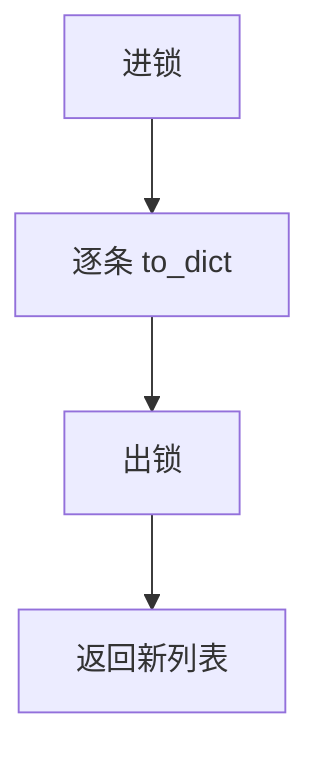

## Q
评论与回复服务（Comments & Replies）的 `get_comments` 为了省事，直接返回了内部的评论列表。线上一个请求线程正把它序列化成 JSON，另一个线程正往其中一条评论里追加回复。会出什么问题？你怎么改？

## A
**每次新建字典与列表，并且整串在锁里生成**

- **调用方能改内部**：对返回值 `clear()` 或追加，就直接写进了服务状态
- **遍历中被改**：列表在遍历时变长，字典可能抛 `RuntimeError`，同一次响应里看到两个时刻
- **两个调用方共享同一份**：一个人的修改变成另一个人的数据
- **一层拷贝就够**：值只有字符串和数字，不可变；容器每次新建，共 `1 + 2n + m` 个对象
- **快照在锁里生成**：否则评论是旧的、回复是新的，同一次读里出现两个时刻
- **`Reply` 设成 `frozen`**：它不变，以后才有机会把"转字典"挪到锁外



```python
def get_comments(self, post_id):
    self._require_post(post_id)
    with self._lock:
        thread = self._threads.get(post_id)
        return thread.snapshot() if thread is not None else []

def to_dict(self):                      # Comment：每次新建，值直接引用
    return {"id": self.id, "post_id": self.post_id, "user_id": self.user_id,
            "content": self.content, "created_at": self.created_at,
            "replies": [r.to_dict() for r in self.replies]}
```

<details class="pt"><summary>延伸</summary>多实例时，ID 改由数据库序列生成（唯一、递增，但可能有空洞），"某一时刻"靠一次查询或一个可重复读的只读事务；读从库还要处理"读自己的写"。</details>

**知识点：** 防御性拷贝（Defensive Copying）、内存模型与可见性（Memory Model）、内存持久化（In-Memory Persistence）
