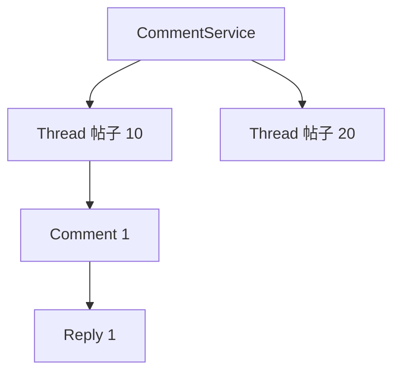

## Q
在评论与回复服务（Comments & Replies）里，回复要找到它的评论，还要确认这条评论属于调用方给的帖子，而且不能每次扫描全站。你要存哪些状态？哪条不变量最要紧？

## A
**每个帖子一个 `Thread`，评论按 ID 放进字典：插入顺序 = 提交顺序 = ID 升序**

- **状态只有四样**：帖子 ID → `Thread`；`Thread` 里评论 ID → `Comment`；评论里的回复列表；两个 `itertools.count(1)`
- **归属由结构保证**：评论只放在自己帖子的 `Thread` 里，用别的帖子找它就是"没找到"，不需要再比较一次
- **一个结构两用**：字典既按 ID 查（O(1)），又按插入顺序遍历，不用另存一份顺序
- **回复只追加**：`Reply` 设成 `frozen`，快照可以共享它
- **ID 在持锁后分配**：于是 ID 升序与列表顺序永远一致
- **空帖子不建 `Thread`**：读到没有评论的帖子，直接返回新的 `[]`



```python
class Thread:
    def __init__(self) -> None:
        self._comments: dict[int, Comment] = {}     # 插入顺序 = ID 升序

    def append(self, comment: Comment) -> None:
        self._comments[comment.id] = comment

    def find(self, comment_id) -> Comment | None:
        return self._comments.get(comment_id) if _is_id(comment_id) else None

# 服务里
self._threads: dict[int, Thread] = {}
self._comment_ids = itertools.count(1)
self._reply_ids = itertools.count(1)
```

<details class="pt"><summary>延伸</summary>要按帖子分页时，因为字典有序，`itertools.islice` 就够，游标用评论 ID 而不是页号；换成数据库时，这个字典对应"帖子 ID + 评论 ID"上的索引。</details>

**知识点：** 内存持久化（In-Memory Persistence）、不变量与封装（Invariants）、值对象与不可变性（Value Objects）
