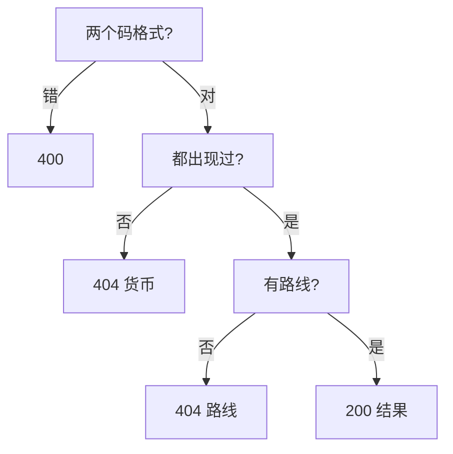

## Q
你要给支付系统写一个汇率换算服务（CurrencyExchangeService）：批量登记有向汇率报价，再查直达汇率、至多一次中转的全部汇率、所有简单路径里的最优汇率。动手写之前，你会先定下哪几条规则，使隐藏测试没有可钻的空子？

## A
**整批原子登记、错误先格式后货币后路线、最优路线以全局最大值为基准选**

- **登记整批原子**：任何一条记录非法或货币超过 8 种，整个调用什么都不改变；成功返回 201 和记录条数（重复也算）
- **输入严格**：货币码 3–5 位大写，不去空白，自报价非法；汇率先过语法再 `float()`，解析值要在 [1e-12, 1e12]，含两端
- **报价有方向**：同一有向对后写覆盖先写，跨调用也一样；登记一个方向不产生反方向
- **错误优先级固定**：两个码的格式 400，其次是否出现过 404 `currency_not_found`，最后 404 `route_not_found`
- **最优路线**：枚举简单路径，乘积从 1 起从左到右连乘；与最大值 M 差不超过 1e-5 的合格，先选边数少、再选货币序列字典序小，返回它自己的乘积
- **返回独立快照**：每次新建字典和列表，数字是 float，只有规定的字段



```python
def _known_pair(self, source, target):
    if not (is_code(source) and is_code(target)):
        raise ServiceError(400, "invalid_input")  # 格式先于未知
    known = self._book.currencies
    if source not in known or target not in known:
        raise ServiceError(404, "currency_not_found")
# 之后才找路线，找不到抛 ServiceError(404, "route_not_found")
```

<details class="pt"><summary>延伸</summary>规则越多越要把 README 里的数字例子先变成测试；容差、平局和优先级这类语义决定自己定，不交给编程智能体顺手选。</details>

**知识点：** 规格与契约（Specifications）、接口的错误契约（Error Contract）、边界校验（Validate at the Boundary）
