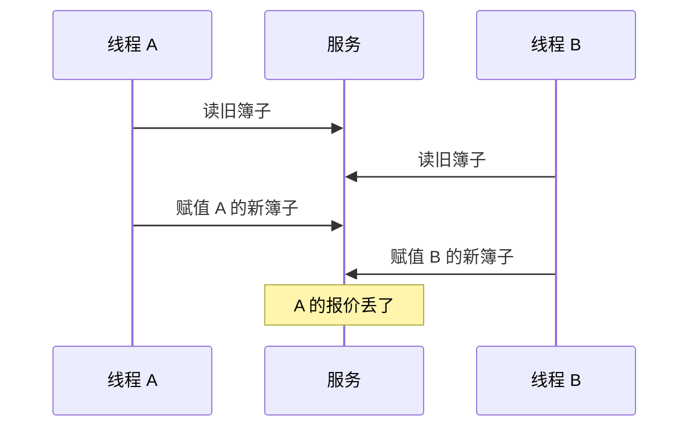

## Q
汇率换算服务（CurrencyExchangeService）收到一批 50 条报价，第 37 条汇率写成了 `oops`；调用方还会把返回的列表直接清空再用。你怎么保证坏批次不留痕、返回值碰不到内部状态？如果两个线程同时登记，这些保证还成立吗？

## A
**先解析后赋值保证原子，新建容器保证隔离，两者都不等于线程安全**

- **坏批次不留痕**：先把 50 条全解析完，第 37 条抛 400 时服务状态还没被碰过；同批更早的覆盖和新货币也不会漏进去
- **合并不改旧簿子**：`extend` 返回新对象，成功才赋值；所以超过 8 种货币也只是抛错，不需要回滚
- **返回值是副本**：每次新建字典和列表，浮点数不可变，不用 `deepcopy`；之后的登记也不会改变已拿到的结果
- **顺序调用才成立**：两个线程各自基于同一本旧簿子合并，后赋值的覆盖先赋值的，一批报价就丢了
- **要线程安全就加锁**：锁包住"读旧簿子、合并、赋值"三步；只给赋值加锁没用



```python
def register_rates(self, rates_stream):
    quotes = parse_quotes(rates_stream)
    with self._lock:  # 并发版：读、合并、赋值是一个复合操作
        self._book = self._book.extend(quotes)
    return 201, {"registered_count": len(quotes)}
```

<details class="pt"><summary>延伸</summary>读多写少时，查询只拿一次 `self._book` 引用就能读到一致的簿子，写入仍要串行；多进程共享时靠数据库事务或带版本号的比较后写入。</details>

**知识点：** 复合操作（Compound Actions）、防御性拷贝（Defensive Copying）、不靠锁的线程安全（Immutability & Confinement）
