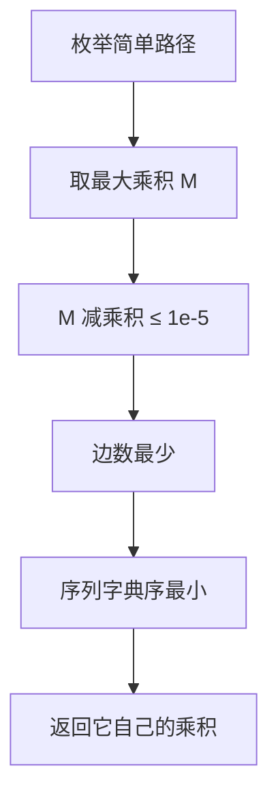

## Q
汇率换算服务（CurrencyExchangeService）里，货币之间可能有环（A→B 与 B→A 都大于 1），最多 8 种货币。你怎么保证最优路线查询会结束、成本可接受？为什么选路线要容差，容差该以什么为基准，返回的汇率为什么有时比最大值小一点？

## A
**简单路径枚举保证结束，容差以全局最大值 M 为基准，返回被选路径自己的乘积**

- **环走不起来**：路径里已有的货币不再进入；走到终点也就停了，因为终点已在路径里
- **成本有界**：8 种货币的完全图，A 到 H 最多 1957 条简单路径，毫秒级；货币数不设上限就会阶乘增长
- **为什么要容差**：`0.1*3.0` 是 `0.30000000000000004`，比直接登记的 `0.3` 大一点点，精确比较会选更长的路线
- **基准是 M**：与 M 差不超过 1e-5 的才合格；以已选路径为基准会沿路径链一步步漂移出范围
- **平局规则**：合格者先比边数，再按货币序列逐个比较，不拼成字符串
- **返回自己的乘积**：被选路径可能比 M 小至多 1e-5，不能换成 M



```python
def best_path(routes):
    found = list(routes)  # (路径, 乘积)
    if not found:
        return None
    top = max(product for _, product in found)
    eligible = [(p, v) for p, v in found if top - v <= TOLERANCE]
    return min(eligible, key=lambda item: (len(item[0]), item[0]))
```

<details class="pt"><summary>延伸</summary>货币更多时要剪枝或预计算；用对数把乘积变成最短路在有套利环时不成立，而且改变了浮点结果与平局规则，语义要重新约定。</details>

**知识点：** 时间与数字（Time & Numbers）、测试用例选择（Partitioning & Boundaries）、容器的选择与惯用法（Collections Idioms）
