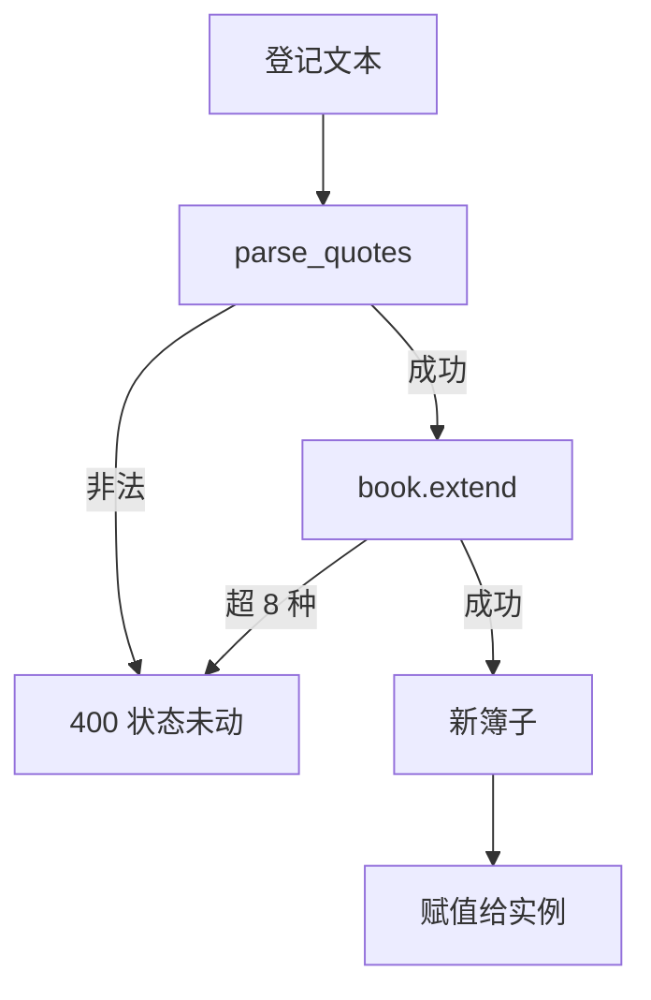

## Q
汇率换算服务（CurrencyExchangeService）要记住所有登记过的汇率，并保证"整批要么全生效、要么全不生效"。你会存哪些状态，怎么组织代码，哪条不变量最要紧？

## A
**一本不可变的汇率簿，登记 = 解析、合并、一次赋值**

- **状态只有一份**：`{(起点, 终点): 汇率}`，存在服务实例上，不放在类或模块里，不同实例互不影响
- **出现过的货币**：由边推出（起点和终点都算），不单独存，也就不会和边不同步
- **最要紧的不变量**：簿子里的货币至多 8 种；簿子构造后不再改变，超限在构造时就抛 400
- **解析与存储分开**：`parse_quotes` 先把整段变成 `Quote` 列表，期间服务状态完全没被碰过
- **失败不用回滚**：`extend` 返回新簿子，旧簿子原封不动，成功之后才赋值给 `self._book`
- **查询只读簿子**：单次中转用邻接表直接查，最优路线用递归枚举，二者都不改状态



```python
def register_rates(self, rates_stream):
    quotes = parse_quotes(rates_stream)          # 整段先解析完
    self._book = self._book.extend(quotes)       # 合并成新簿子；超限在这里抛错
    return 201, {"registered_count": len(quotes)}  # 唯一的一次写入
```

<details class="pt"><summary>延伸</summary>换成数据库时，"解析、合并、赋值"变成一个事务；报价要随时间失效或实时更新时，簿子带版本号，查询读某个版本的快照。</details>

**知识点：** 不变量与封装（Invariants）、值对象与不可变性（Value Objects）、防御性拷贝（Defensive Copying）
