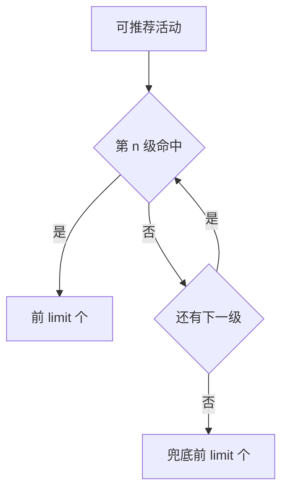

## Q
在票务市场的活动推荐服务（SeatScout Event Campaigns）里，要修复一套可组合的推荐规则：离我多远、这个周末、五十美元以下，再由推荐器分级尝试。线上反馈是周日的演出从来不出现、售罄的便宜票被推荐、有些客户一场都收不到。开工前你会先定下哪几条规则？

## A
**先把合同写成六条带边界的断言，再让智能体改代码。**

- **出发点与缺失**：分享的位置优先，其次才是家所在城市的坐标；缺位置不是距离 0，是"不匹配"，也不抛异常；半径含边界
- **两个时间窗口**：`within_days` 是 `[now, now + d×24h]` 两端含；`this_weekend` 是 `[周六 00:00, 下周一 00:00)` 且不早于 `now`，周一到周五指即将到来的那个，周六日指正在过的
- **价格**：同一张票既有货（数量 > 0）又严格低于上限，两个条件不能分别由两张票满足
- **组合**：`all_of` 全部匹配，空时为真；`any_of` 任一匹配，空时为假；可嵌套，也装得下别处写的规则
- **推荐顺序**：可推荐 = 没开始且有票，按 `(开始时间, id)`；逐级尝试，先匹配、后截断到 `limit`
- **兜底**：没有任何级别命中时，对每位客户都返回前 `limit` 个可推荐活动，只有没有可推荐活动时才为空



```python
eligible = [e for e in self._events if self._eligible(e, now)]   # 已排序
for tier in campaign.tiers:
    hits = (e for e in eligible if tier.matches(e, context))
    matched = [e.id for e in islice(hits, campaign.limit)]       # 先匹配后截断
    if matched:
        return matched
return [e.id for e in islice(eligible, campaign.limit)]          # 兜底
```

<details class="pt"><summary>延伸</summary>题目给的例子在修复前的代码上也能通过，所以每个现象要有自己的失败测试：周日 19:00、卖光的便宜票、两位客户共用一个规则、最早几场都在远处。</details>

**知识点：** 规格与契约（Specifications）、用例选择（Partitioning & Boundaries）、时间与数字（Time & Numbers）
