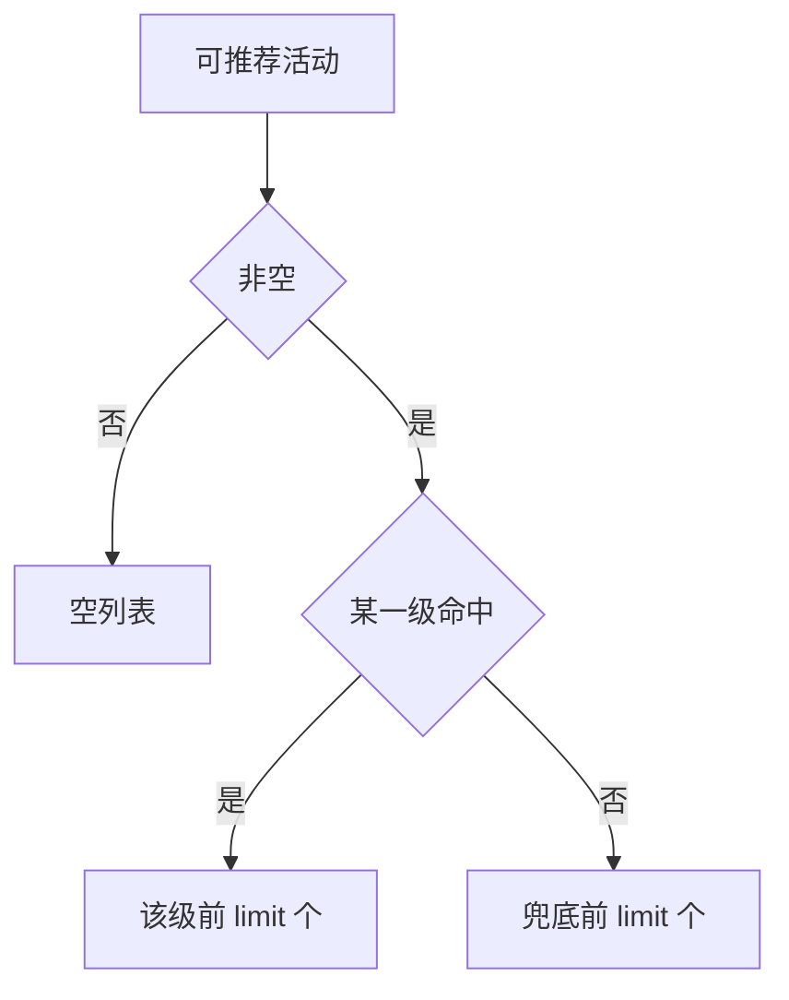

## Q
活动推荐服务（SeatScout Event Campaigns）里，有的客户既没分享位置也没有家，几乎没有信号；还有的客户所有级别都不命中，却收到空列表。你怎么保证每位客户都有推荐，怎么让兜底结果仍然相关，又怎么在数据分析里看见哪些客户走了兜底？

## A
**保证来自结构：只要有可推荐活动，推荐器自己就会兜底，不靠任何一级规则的数据质量。**

- **先匹配、后截断**：对整个可推荐集合匹配，再取前 `limit` 个；先截断会让"最早几场都不相关"变成空列表
- **兜底对每位客户一样**：不看有没有位置、有没有家，只在没有可推荐活动时才为空
- **缺信息是不匹配**：规则不抛异常，也不把"不知道"当成匹配，所以不会有人被一条坏数据拖垮
- **保持相关**：兜底不必纯按时间，可以按所在地区的热度排；规则仍然不改
- **看得见**：让结果带上"命中的级别序号，或兜底"，记入埋点，按天看兜底率
- **兜底率突然升高**：多半是某条规则的数据坏了，或客户群里缺位置的比例变了



```python
eligible = [e for e in self._events if self._eligible(e, now)]
for tier in campaign.tiers:
    hits = (e for e in eligible if tier.matches(e, context))
    matched = [e.id for e in islice(hits, campaign.limit)]
    if matched:
        return matched
return [e.id for e in islice(eligible, campaign.limit)]   # 对每位客户一样
```

<details class="pt"><summary>延伸</summary>结果改成带来源的小对象（列表加级别序号或 "fallback"）时，调用方只多读一个字段；兜底按热度排序时，排序放在 `Recommender`，规则不动。</details>

**知识点：** 返回值设计（Return Values）、缺失值的表示（Optional & Null）、用例选择（Partitioning & Boundaries）
