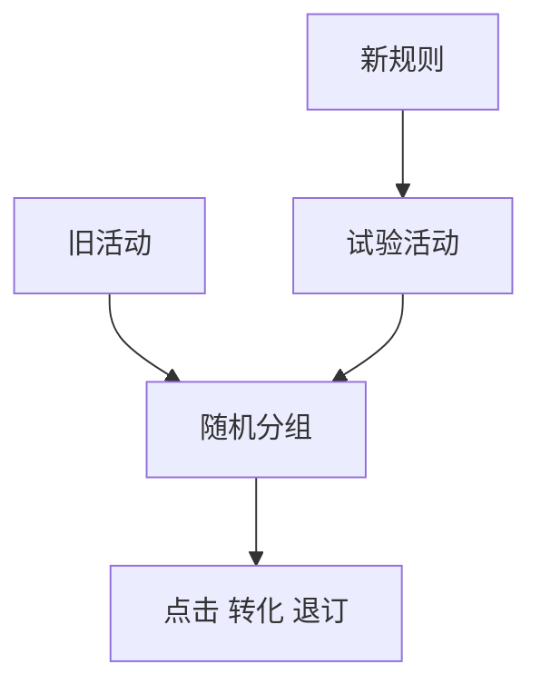

## Q
活动推荐服务（SeatScout Event Campaigns）里，运营想加一条「来自客户家乡的艺人」规则，但没人知道它到底有没有用，也不想让所有活动立刻依赖它。你怎么不改推荐器就把它上线，又怎么先用一小部分真实流量验证、看什么指标？

## A
**新规则是一个带 `matches` 的类，只放进一个试验活动；先对照，有效再推广。**

- **不改推荐器**：`Rule` 是协议，只要有 `matches(event, context)` 就是规则，不必继承任何基类
- **可安全复用**：规则只带构造参数（比如一张艺人目录），答案只看 `event` 与 `context`，所以放进多少活动、服务多少客户都不串
- **只进一个新活动**：把它放在试验活动的某一级，旧活动一行不动，回滚就是删掉那个活动
- **先影子，再放量**：对同一批客户同时算旧结果和新结果，只展示旧的，比较"新规则独有的命中"占多少
- **随机小流量对照**：同一时间段、随机分组，不拿"这周对上周"当对照
- **指标**：点击率、购买转化、取消订阅，另看新规则命中比例和兜底率



```python
@dataclass(frozen=True)
class HometownArtist:                         # 不继承任何基类
    catalog: Mapping[str, frozenset[str]]     # 城市 -> 本地艺人

    def matches(self, event, context) -> bool:
        home = context.customer.home_city
        return home is not None and event.name in self.catalog.get(home, ())

trial = Campaign("trial", [HometownArtist(CATALOG), *old.tiers], old.limit)
```

<details class="pt"><summary>延伸</summary>新规则要的数据不在 context 里时，给冻结的 `RecommendationContext` 加一个字段，旧规则不受影响；活动存进数据库时，规则类各加一对序列化函数。</details>

**知识点：** 结构型模式（Structural）、接口演进（API Evolution）、选择与拒绝模式
