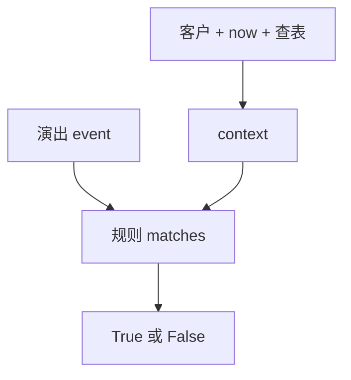

## Q
在活动推荐服务（SeatScout Event Campaigns）里，同一个距离规则对象被很多客户、很多活动共用，结果后发的客户拿到了先发客户附近的演出。规则里该存哪些状态？哪条不变量最要紧？

## A
**规则只带构造参数；一条规则的答案只取决于它收到的 `event` 和 `context`。**

- **状态只有两处**：规则里是半径、天数、上限这类配置；`Recommender` 里是构造时排好序的演出元组
- **易变输入全走 `context`**：客户、现在几点、位置服务、库存都在里面，规则不能自己读时钟，也不能记上次的结果
- **冻结是语言层的保证**：`frozen=True` 的数据类，给实例赋值直接抛错，不靠自觉
- **共享可变状态就是串数据的原因**：规则上按城市记的距离，下一位客户直接读到；缺位置时记的 `0.0` 还会让所有人"就在演出地"
- **要缓存就放在一次调用里**：键包含出发点，调用结束就丢
- **没有锁也线程安全**：规则与活动不可变，推荐器构造后只读



```python
@dataclass(frozen=True, slots=True)
class WithinMiles:
    miles: float                                    # 只有配置，没有缓存

    def matches(self, event, context) -> bool:
        origin = origin_of(context.customer, context.locations)
        target = context.locations.coordinates_of(event.city)
        if origin is None or target is None:
            return False                            # 不知道 ≠ 距离 0
        return context.locations.distance_miles(origin, target) <= self.miles
```

<details class="pt"><summary>延伸</summary>演出多到每次都算距离太慢时，先用城市索引缩小候选，再在候选上跑规则；规则本身不变，变的是候选集合怎么得到。</details>

**知识点：** 值对象与不可变性（Value Objects）、结构型模式（Structural）、缓存与记忆化（Caching & Memoization）
