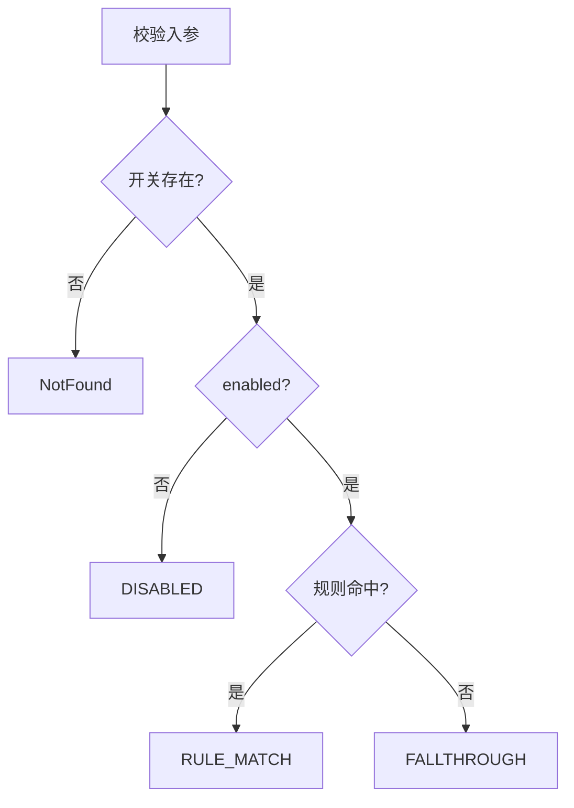

## Q
在功能开关与实验分组服务里，`evaluate(key, user_id, attributes)` 要按开关配置的「启停、有序规则、百分比放量」决定用户看到哪个变体，并返回 `{value, reason, rule_index?}`。开工前你会先定下哪几条规则？

## A
**先停用、再按序首个命中、最后分桶；缺失与类型不符只算不命中，从不抛异常**

- **停用先于一切**：`enabled=false` 直接返回 `default_variant`，原因 `DISABLED`，规则与放量都不看
- **首个命中赢**：规则自上而下，条件之间 AND，空条件命中所有人；`rule_index` 只在 `RULE_MATCH` 里出现
- **缺失或类型不符 = False**：包括 `neq`、`not_in`，缺属性时它们也不命中；`gt`/`lt` 的布尔不是数字
- **相等看类型**：`true` 不等于 `1`，`10**23` 不等于 `1e23`，`5` 等于 `5.0`
- **放量区间按 `variants` 顺序、左闭右开**：桶号 8000 属于第二个变体，不是第一个
- **校验先于存储**：放量表必须是整数、非负、总和恰好 100；非法配置不留痕



```python
def evaluate(self, user_id, attributes):
    if not self.enabled:
        return {"value": self.default_variant, "reason": "DISABLED"}
    for index, rule in enumerate(self.rules):
        if rule.matches(attributes):      # 条件 AND；空列表命中所有人
            return {"value": rule.serve, "reason": "RULE_MATCH",
                    "rule_index": index}
    return {"value": self.pick(bucket(self.key, user_id)),
            "reason": "FALLTHROUGH"}
```

<details class="pt"><summary>延伸</summary>操作符用一张名字到函数的字典，不为七个操作符各建一个类；`user_id` 与 `attributes` 的校验排在「开关是否存在」之前，所以对不存在的开关传空 `user_id` 得到 400，不是 404。</details>

**知识点：** 规则引擎（Rule Engine）、策略模式与可替换算法（Strategy）、边界校验（Validate at the Boundary）
