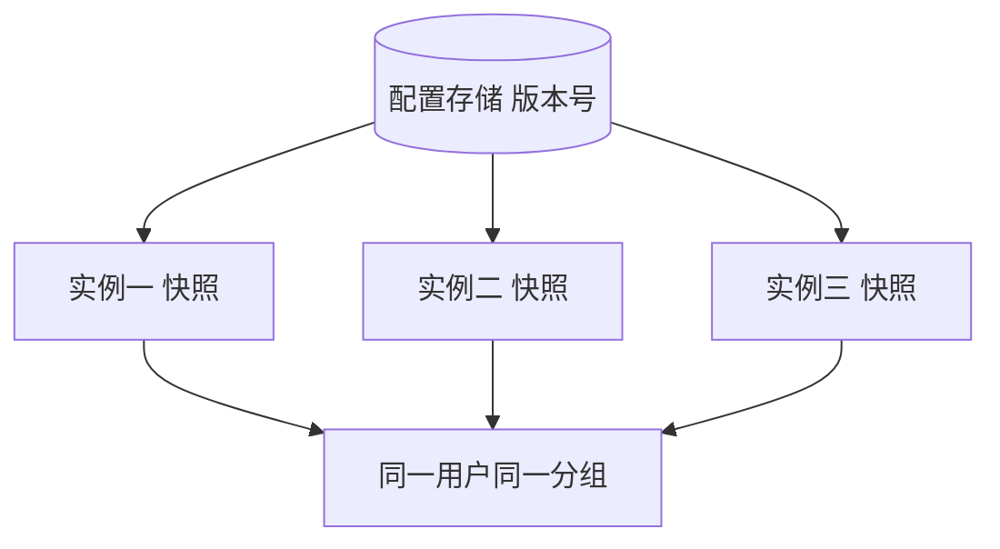

## Q
功能开关服务要开三个实例放在负载均衡后面，同一个用户不管被转发到哪个实例，都必须得到同一个分组；运营改了配置之后，各实例也要尽快一起生效。配置怎么在实例之间共享，才不会让用户的分组乱掉？

## A
**只共享带版本号的配置；分桶是纯函数，配置一致则分组一致，不需要共享分配表**

- **分桶无状态**：结果只取决于（配置，`flag_key`，`user_id`），三个实例配置相同，答案必然相同
- **配置是唯一要共享的东西**：放在数据库或配置中心，每次保存得到一个单调递增的版本号
- **本地缓存快照**：每个实例求值读本地的冻结 `Flag`，不在请求路径上远程读取
- **整份替换**：拉取或订阅到新版本，就换掉本地整张表，和单进程里的更新同一招
- **版本只前进**：旧版本的消息迟到时直接丢弃，不能把新配置覆盖回去
- **短暂不一致可接受**：传播期间可能一个实例用旧版、一个用新版；分组只在区间边界处变化，要更强的保证就在响应里带版本号



```python
def apply_snapshot(self, version, configs):
    parsed = {c["key"]: parse_flag(c) for c in configs}  # 锁外先校验
    with self._lock:
        if version <= self._version:
            return                       # 迟到的旧版本不能覆盖新版本
        self._flags, self._version = parsed, version
```

<details class="pt"><summary>延伸</summary>推送可能丢，所以订阅之外还要定期全量拉取兜底；分析实验结果时把版本号和分组一起记入日志，才能还原某个用户当时看到的配置。</details>

**知识点：** 内存持久化（In-Memory Persistence）、线程安全结构的写法（Thread-Safe Structures）、复合操作（Compound Actions）
