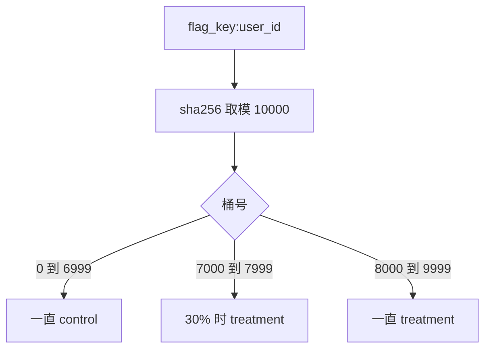

## Q
在功能开关服务里，实验 `checkout_flow` 的放量要从 20% 提到 30%，产品要求「已经看到 treatment 的用户不能被换回 control」。分桶哈希里为什么放 `flag_key` 和 `user_id`，却不放放量比例？比例调整时到底谁的分组会变？

## A
**桶号只由 (flag_key, user_id) 决定；比例只移动区间边界，所以只有新划进来的用户变化**

- **放 `user_id`**：同一用户每次得到同一个桶，不必存分配表，多个实例也一致
- **放 `flag_key`**：不同开关用不同的桶，否则同一批用户会在所有实验里同时被放进 treatment
- **不放比例**：比例进了哈希，每调一次比例全员重新洗牌，已入组用户会被换走
- **边界移动**：80/20 变 70/30，treatment 区间从 [8000, 10000) 扩成 [7000, 10000)，只有桶号在 [7000, 8000) 的用户从 control 变 treatment
- **实测 10000 个用户**：treatment 从 1974 个增加到 3000 个，原来的 1974 个全部保留，换组的 1026 个正好是桶号在 [7000, 8000) 的人
- **变体顺序也是分组的一部分**：区间按 `variants` 顺序累计，把 `["control","treatment"]` 调成 `["treatment","control"]`，同样 80/20 下有 3937 个用户换组



```python
def bucket(flag_key, user_id):
    digest = sha256(f"{flag_key}:{user_id}".encode("utf-8")).hexdigest()
    return int(digest, 16) % 10000          # 不用 random，也不用 hash()

def pick(self, bucket_number):              # rollout 已按 variants 顺序排好
    upper = 0
    for variant, percent in self.rollout:
        upper += percent * 100              # 一个百分点 100 个桶
        if bucket_number < upper:           # 左闭右开
            return variant
```

<details class="pt"><summary>延伸</summary>Python 内置的 `hash("user-1") % 10000` 每个进程的结果不同（连续两次运行得到 7023 和 8047），不能拿来分桶；想把放量调小时，被挤出区间的用户一定是区间末尾那一段，这是按序累计区间的代价。</details>

**知识点：** 策略模式与可替换算法（Strategy）、不变量与封装（Invariants）、值对象与不可变性（Value Objects）
