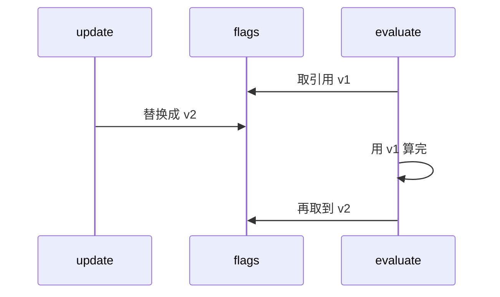

## Q
在功能开关服务里，运营在改一个开关的配置，同一时刻另一些线程正在为用户求值，调用方还会修改拿到的配置字典。你要存哪些状态？哪条不变量最要紧？怎样保证求值不会读到只更新了一半的配置？

## A
**存冻结的整份 `Flag`；更新是一次引用替换，求值只会读到完整旧版或完整新版**

- **状态只有一个字典**：`key → Flag`，外加一把锁，别无其他
- **最要紧的不变量**：存进去的 `Flag` 已校验、已规范化、不可变（冻结 dataclass，规则与条件是元组）
- **更新**：锁外先 `parse_flag` 造好新 `Flag`，锁内一次赋值替换；校验失败时旧版原封不动
- **求值**：锁内只取引用，锁外计算；拿到手的引用不会再被任何线程改
- **返回值隔离**：每次由 `to_config()` 生成新字典，`in` 列表也深拷贝；入参在创建之后被改不影响存储
- **反例**：原地改旧 `Flag` 的字段，读者会看到新规则配旧变体表



```python
def update_flag(self, key, config):
    flag = parse_flag(config)               # 锁外：校验并造冻结对象
    _require(flag.key == key, "key mismatch")
    with self._lock:
        if key not in self._flags:
            raise NotFoundError(key)
        self._flags[key] = flag             # 一次引用替换
    return flag.to_config()

def evaluate(self, key, user_id, attributes=None):
    with self._lock:
        flag = self._flags.get(key)         # 锁内只取引用
    return flag.evaluate(user_id, attributes or {})   # 锁外计算
```

<details class="pt"><summary>延伸</summary>读多写少时可让整张字典也是不可变快照，写者复制后整体替换，求值完全无锁（写时复制，copy-on-write）；换成数据库后，「整份替换」对应一次事务里换掉整行，而不是逐字段更新。</details>

**知识点：** 复合操作（Compound Actions）、值对象与不可变性（Value Objects）、防御性拷贝（Defensive Copying）、内存持久化（In-Memory Persistence）
