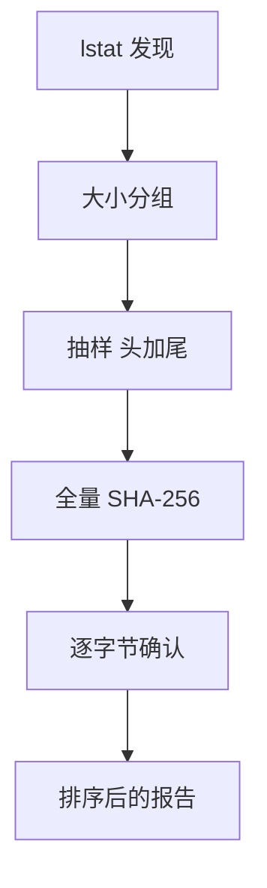

## Q
你拿到一个文件去重流水线（ArchiveSweep）：递归扫描文件和目录，按大小和首尾抽样预筛，流式 SHA-256，再逐字节确认，最后按固定顺序报告重复组和问题。对智能体说第一句话之前，你会先定下哪几条规则？这些规则是隐藏测试最容易盯住的。

## A
**路径身份、漏斗顺序、抽样边界、碰撞安全、失败记账：五件事先写成清单**

- **路径身份是字符串**：`str(Path(p))` 相同就只处理一次；软链接、缺失路径、特殊文件各记一条 `FileIssue`，不跟随
- **大小先行**：大小唯一的文件不进抽样，也不做可读性检查，一个 `open` 都不该有
- **抽样头加尾且不重叠**：头读 `min(s, size)`，尾从 `max(head, size - s)` 起；最多读 `2 × sample_size`
- **摘要相同还要逐字节确认**：碰撞桶按内容拆成多个重复组；`canonical` 是字符串最小的路径
- **失败只隔离出错的文件**：同一路径只留最近一条问题；比较失败记在出错的那一边
- **`bytes_hashed` 只数两个钩子**：成功返回才计，抛异常记 0，逐字节比较读的不计



```python
def _sample_fingerprint(self, path, size):
    head = min(self.sample_size, size)
    tail_start = max(head, size - self.sample_size)  # 两段不重叠
    digest = hashlib.sha256()
    with open(path, "rb") as stream:
        nread = _feed(stream, digest, head)
        if tail_start < size:
            stream.seek(tail_start)
            nread += _feed(stream, digest, size - tail_start)
    return digest.hexdigest(), nread
```

<details class="pt"><summary>延伸</summary>文件数大到内存放不下时，把（大小，路径）按大小分片落盘，每个分片单独去重；跨次扫描再缓存（路径，大小，修改时间，摘要），只重算变了的文件。</details>

**知识点：** 规格与契约（Specifications）、边界校验（Validate at the Boundary）、流式处理大文件（Streaming Large Files）
