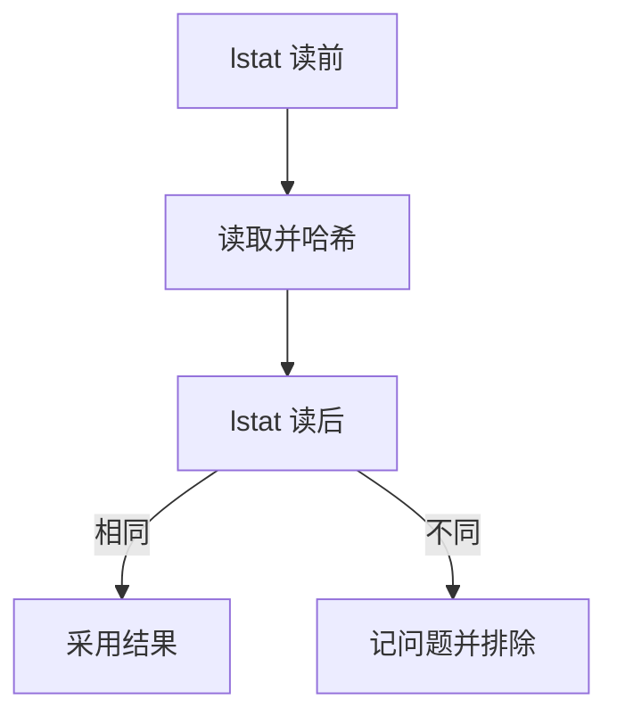

## Q
文件去重流水线（ArchiveSweep）正在扫描一个归档目录，其中一个日志文件还被另一个进程不停追加：发现时它是 1000 字节，抽样时已经更长，全量哈希时又更长。你的实现会把它判成什么？你怎样让它检测到这种变化并安全处理？

## A
**逐字节比较保证比较那一刻不会误判相同；检测靠读前读后各 `lstat` 一次，变了就记问题并排除**

- **比较时不会判错**：成组只看最后一次逐字节比较读到的内容，变了的文件最多是漏报；比较之后再变，报告就过期了，所以要靠读前读后的快照
- **发现时的大小只是提示**：抽样只读到旧大小处，全量读到新内容，摘要与旧伙伴不同，文件被淘汰且没有问题
- **检测变化**：读之前、读之后各 `lstat`，比较（大小，`mtime_ns`，inode），不同就记"读取期间被修改"并排除
- **同长度的重写**：修改时间纳秒会变，能发现；被人把修改时间设回去的只能靠最后的字节比较兜底
- **要同一时刻的视图**：对文件系统快照扫描，所有读取看到同一个时间点
- **别信缓存的结论**：`filecmp.cmp` 按（大小，修改时间）缓存，同修改时间的改写仍报"相同"



```python
def snapshot(path):
    st = os.lstat(path)
    return (st.st_size, st.st_mtime_ns, st.st_ino)

def read_stable(path, digest_fn):
    before = snapshot(path)
    result = digest_fn(path)
    if snapshot(path) != before:
        raise RuntimeError("file changed while being read")
    return result
```

<details class="pt"><summary>延伸</summary>规模变大后，最稳的做法是让写入方先写临时名再原子改名，或扫描存储层的快照；对象存储里对象不可变，同一个版本号读到的内容不会变。</details>

**知识点：** 复合操作（Compound Actions）、流式处理大文件（Streaming Large Files）、缺陷与预期失败（Bugs vs Failures）
