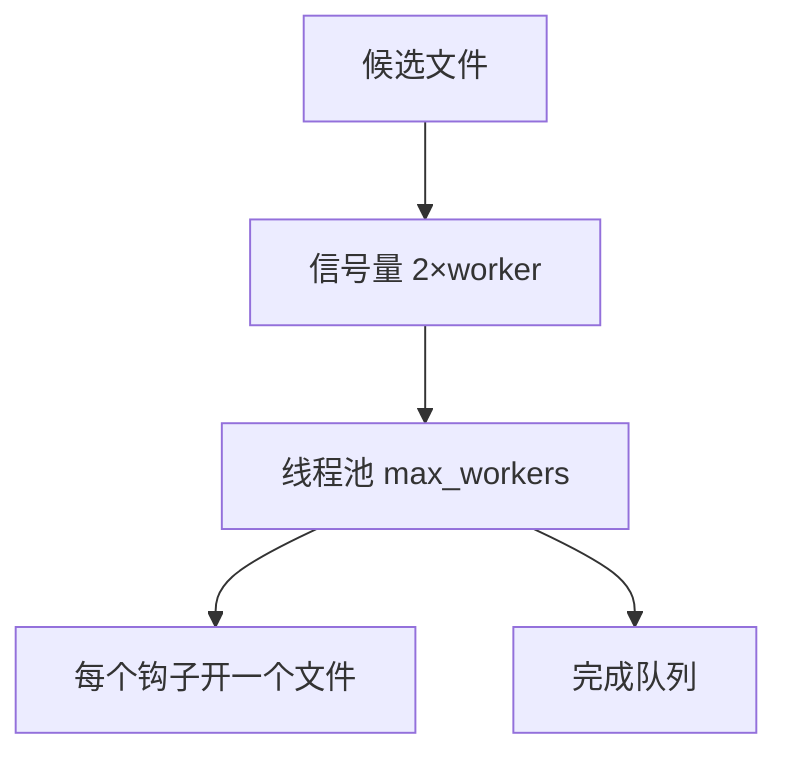

## Q
同一份文件去重代码（ArchiveSweep）要分别跑在本机固态盘、公司的网络文件系统和对象存储上。`max_workers`、在途任务数、同时打开的文件数各怎么定？为什么三种存储不能用同一组数字？

## A
**先算资源：每个钩子一个打开的文件，worker 数跟着"设备能同时服务多少请求"走**

- **同时打开的文件 = `max(max_workers, 2)`**：每个钩子开一个，逐字节比较开两个
- **本机固态盘（经验法则）**：哈希耗处理器，`hashlib` 处理大块时释放 GIL，worker 取接近核数；机械盘随机读慢，1 到 2 个
- **网络文件系统（经验法则）**：延迟主导，可以多开，但要设上限保护服务端、避免句柄耗尽；读块要大
- **对象存储**：每次读是一个请求，抽样改成范围请求只取首尾，能用对象自带的大小和校验和先分组就少读；worker 受限速与计费约束
- **在途任务要有界**：现在一次提交全部候选，500 个文件就是 500 个排队任务；用信号量限制为 `2 × worker`
- **内存**：`max_workers × 块大小` 加队列里的小对象，与文件大小无关



```python
slots = threading.BoundedSemaphore(2 * workers)

def run(item):
    try:
        return fn(item)
    finally:
        slots.release()

with ThreadPoolExecutor(workers) as pool:
    futures = []
    for item in items:
        slots.acquire()  # 在途任务到上限就在这里等
        futures.append(pool.submit(run, item))
    results = [f.result() for f in futures]
```

<details class="pt"><summary>延伸</summary>数字不是常量而是要测的：固定 worker 数跑一遍，看设备的吞吐在哪个并发数停止增长，再往下留余量；多机时每台机器的上限相加不能超过共享存储的上限。</details>

**知识点：** 并发模式、并行加速与锁竞争（Parallel Speedup & Contention）、流式处理大文件（Streaming Large Files）
