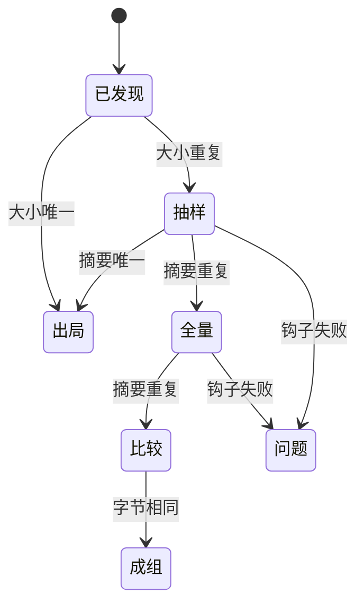

## Q
文件去重流水线（ArchiveSweep）的一次 `scan` 在内存里要记住什么？抽样和全量哈希在线程池里并发执行，这些状态由谁来改？哪条不变量一旦破了，后果最严重？

## A
**状态只让一个协调线程改；最要紧的不变量是"同组任意两个成员字节相同"**

- **`files`**：路径身份 → 发现时记下的大小，只含普通文件；`files_considered` 就是它的长度
- **`issues`**：路径 → 最近一条错误；以路径为键，"同一路径只留一条"不需要额外代码
- **`_Batch`**：一批文件还剩几个钩子没回来、按摘要分了哪些桶；`left` 减到 0 才决定谁进下一级
- **`hashed`**：只在钩子正常返回时累加；抛异常的钩子记 0
- **单写者**：工作线程只返回值，完成通知进队列，一个线程改全部状态，所以不需要锁
- **最要紧的不变量**：摘要只缩小候选，成组的依据只有逐字节比较；身份是路径不是 inode，两个硬链接是两个成员



```python
while in_flight:
    future, batch, path = done.get()
    in_flight -= 1
    try:
        digest, nread = future.result()
    except Exception as exc:
        issues[str(path)] = describe(exc)  # 抛异常的钩子记 0
    else:
        hashed += nread
        batch.buckets[digest].append(path)
    batch.left -= 1
    if not batch.left:
        for bucket in batch.buckets.values():
            if len(bucket) > 1:  # 唯一的摘要不再往下读
                launch("full", batch.size, bucket)
```

<details class="pt"><summary>延伸</summary>候选任务现在一次全部提交，在途任务数与文件数成正比；用信号量把"已提交未完成"限制在 2 × worker 以内，内存才与文件数无关。</details>

**知识点：** 不变量与封装（Invariants）、并发模式、线程安全结构的写法（Thread-Safe Structures）
