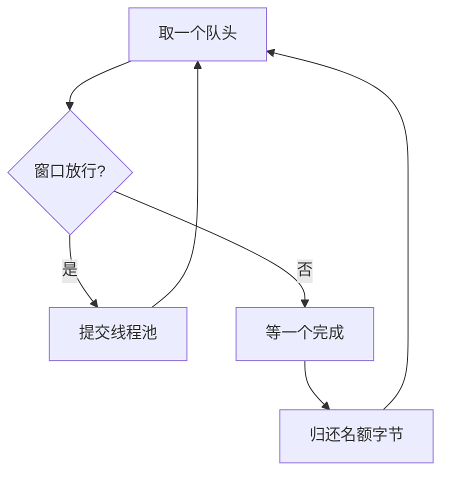

## Q
你拿到一个图片变换流水线（PixelFlow）：每张图按同一条变换链依次处理，不同图并发，要保序、隔离失败、按先进先出和在途原图字节预算准入，输入是只能读一遍的迭代器。对智能体说第一句话之前，你会先定下哪几条规则？这些规则是隐藏测试最容易盯住的。

## A
**结果、失败、上限、准入、取用：五组规则先写成清单**

- **结果按输入下标**：每个被取出的输入恰好一个结果，`index` 从 0 起，重复的 `image_id` 各占一项
- **失败只停这一张图**：`Exception` 变成 `data=None` 加 `"类型名: 消息"`，后面的变换不再调用；`BaseException` 原样抛出
- **worker 上限也是下限**：同时在跑不超过 `max_workers`，凑齐 `max_workers` 张阻塞时必须真能同时跑（串行不合格）
- **先进先出准入**：队头放不进去，后面更小的也不能插队
- **预算计原图字节**：从提交计到整条链成功或失败；超大的队头只在没有别的图在途时放行
- **惰性取用**：只迭代一次、一次一个；全部阻塞时最多要过 `max_workers + 1` 项



```python
def can_admit(self, size: int) -> bool:
    if self._jobs >= self._max_jobs:
        return False
    if self._jobs and self._bytes + size > self._byte_limit:
        return False  # 在途为空时，超大的队头也放行
    return True
```

<details class="pt"><summary>延伸</summary>恰好等于预算要放行（用 `>` 拒绝，不是 `>=`）；预算口径只数原图字节，输出和解码缓冲不算；0 字节的图在超大图在途时也不放行，这一条是需要自己拍板的边界。</details>

**知识点：** 规格与契约（Specifications）、并发模式、边界校验（Validate at the Boundary）
