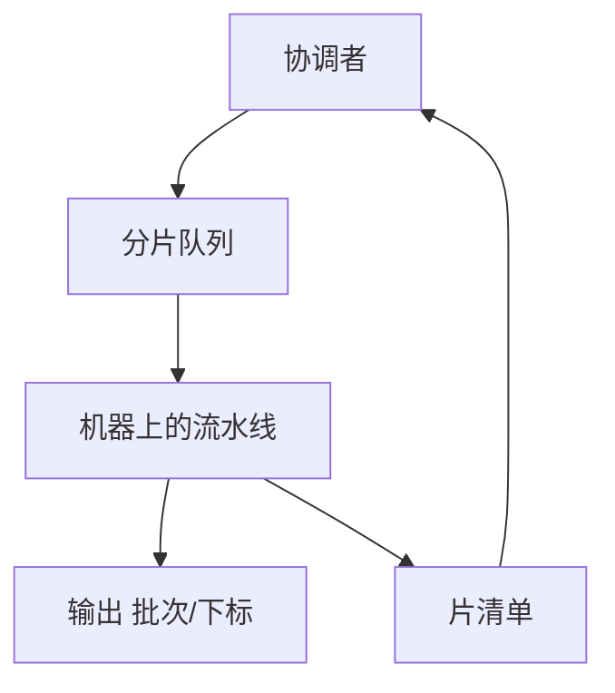

## Q
图片变换流水线（PixelFlow）要处理一百万张图，分给很多台机器。同一批可能被重跑，`image_id` 还允许重复，结果必须按输入顺序可取。你怎么切分、怎么标识输出、怎么保证重跑不产生重复结果？

## A
**按下标分片，输出键由下标决定，重跑覆盖同一个键**

- **分片**：按输入下标区间切，每片 5000 张就是 200 片；片是调度和重试的单位
- **幂等键**：`(批次号, 下标)`，不是 `image_id`（允许重复）；输出写到确定的键，重跑覆盖同一个对象
- **顺序**：片内用这个流水线（保序）；片之间不排序，按下标键取或按片号拼接
- **失败**：单图失败记进片的清单（下标和错误）；片级重试只重做没成功的下标
- **提交点**：清单最后写，清单在才算这一片完成，半个片读者看不见
- **背压**：协调者一次只给一台机器发一片，机器内部仍是预算准入，两层各有一个窗口



```python
def shard_ranges(total: int, size: int) -> list[range]:
    return [range(s, min(s + size, total)) for s in range(0, total, size)]

def output_key(batch: str, index: int) -> str:
    return f"{batch}/{index:08d}"  # 确定的键：重跑覆盖同一个对象
```

<details class="pt"><summary>延伸</summary>一百万张、每片 5000 张是 200 片，下标 999999 的键是 `batch/00999999`。至少一次投递加确定的键，等价于恰好一次的效果；要换成进程池时，预算口径翻倍（父子进程各一份）。</details>

**知识点：** 重试与退避（Retry & Backoff）、大结果集接口（Pagination & Iteration）、线程、进程与协程的选择（Choosing a Model）
