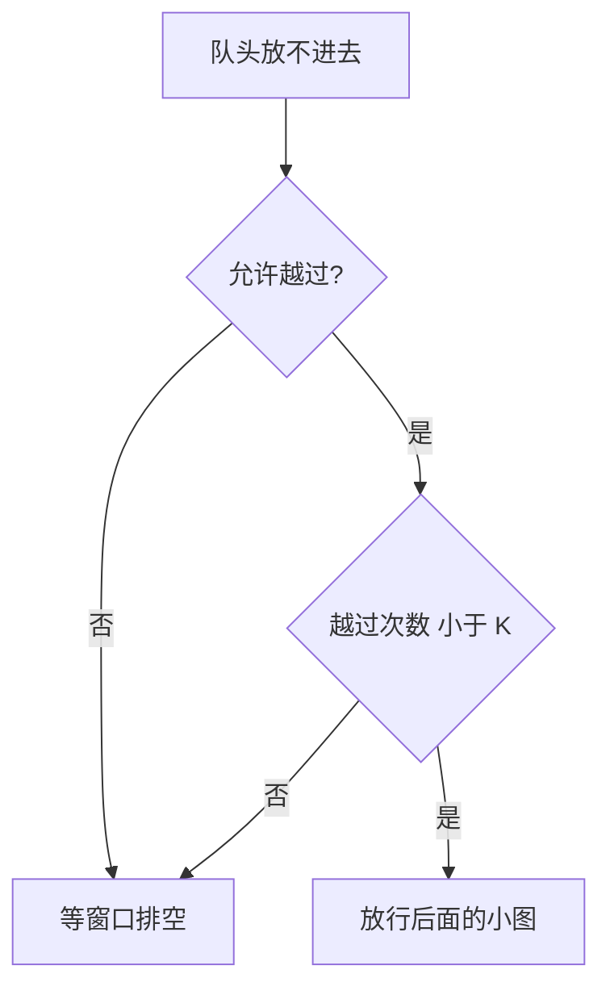

## Q
图片变换流水线（PixelFlow）的一批里夹着一张比整个预算还大的原图，后面跟着成百上千张小图。先进先出让它独自占住窗口，其余 worker 都空着；让后面的小图先跑，吞吐会高很多。你怎么取舍？代价各是什么？

## A
**先进先出：拿吞吐换每张图的等待有上界**

- **代价**：超大队头独占窗口时，其余 `max_workers − 1` 个 worker 空转
- **越过队头的后果**：后面只要不断有小图，窗口就不会空，队头永远等不到；等待没有上界
- **先进先出的保证**：队头前面最多 `max_workers` 张图，它们跑完就轮到队头
- **折中一**：预算留余量，让大图少出现
- **折中二**：有界越过，队头最多被越过 `K` 次，之后强制排空；`K` 是公平度的旋钮
- **折中三**：大图走单独的队列和 worker 配额，小图不受影响



```python
MAX_BYPASS = 8  # 队头最多被越过 8 次

def next_admissible(head, rest, window, bypassed):
    if window.try_admit(len(head.data)):
        return head, 0
    if bypassed >= MAX_BYPASS:
        return None, bypassed  # 强制排空：不再越过
    for i, job in enumerate(rest):
        if window.try_admit(len(job.data)):
            return rest.pop(i), bypassed + 1
    return None, bypassed
```

<details class="pt"><summary>延伸</summary>同样的纯逻辑模拟（3 个名额、预算 10、窗口里已有两张 3 字节的图、队头 8 字节、后面 40 张 3 字节的图）：先进先出第 2 步放行队头，越过队头要到第 42 步。换成进程池或多机时，每一层都有自己的窗口。</details>

**知识点：** 并发模式、并行加速与锁竞争（Parallel Speedup & Contention）、线程池（Thread Pool）
