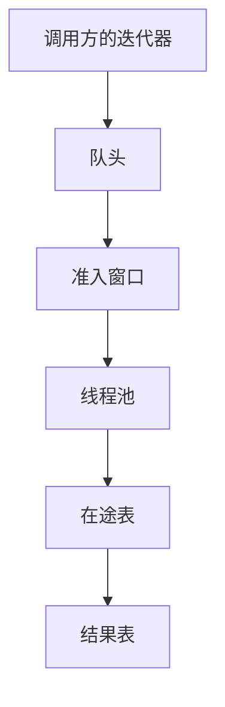

## Q
在图片变换流水线（PixelFlow）里，一次 `run` 要记住哪些状态？谁来改它们？哪条不变量最要紧，怎样不用锁也保住它？

## A
**状态只让调用 `run` 的协调线程改，工作线程只返回值**

- **窗口**：在途任务数加在途原图字节；每次放行加、每次完成减
- **在途表**：future 到它占用的字节；完成时按它归还，不重新计算
- **结果表**：输入下标到结果；最后按 `0..n-1` 取出，顺序与完成顺序无关
- **队头**：已取出但还没放行的一项；它不放行就不再取下一项（先进先出和惰性取用是同一个变量）
- **不变量**：在途数不超过 `max_workers`；在途字节不超过预算，唯一的例外是窗口里只有那一张超大的图
- **失败路径也要还**：成功或失败都归还名额和字节，否则后面的图永远进不去，`run` 挂死



```python
while not exhausted and window.has_slot:
    if head is None:
        head = next(source, None)
        if head is None:
            exhausted = True
            break
    index, job = head
    size = len(job.data)
    if not window.try_admit(size):
        break  # 队头放不进去：后面的一律不取
    in_flight[pool.submit(self._run_one, index, job, chain)] = size
    head = None
```

<details class="pt"><summary>延伸</summary>窗口不是线程安全的，这是有意的：只有协调线程调用它，把"线程安全"的范围缩到零；记账出错用 `RuntimeError` 而不是 `assert`，免得 `python -O` 把它去掉。</details>

**知识点：** 不靠锁的线程安全（Immutability & Confinement）、不变量与封装（Invariants）、所有路径上的清理（Cleanup on Every Path）
