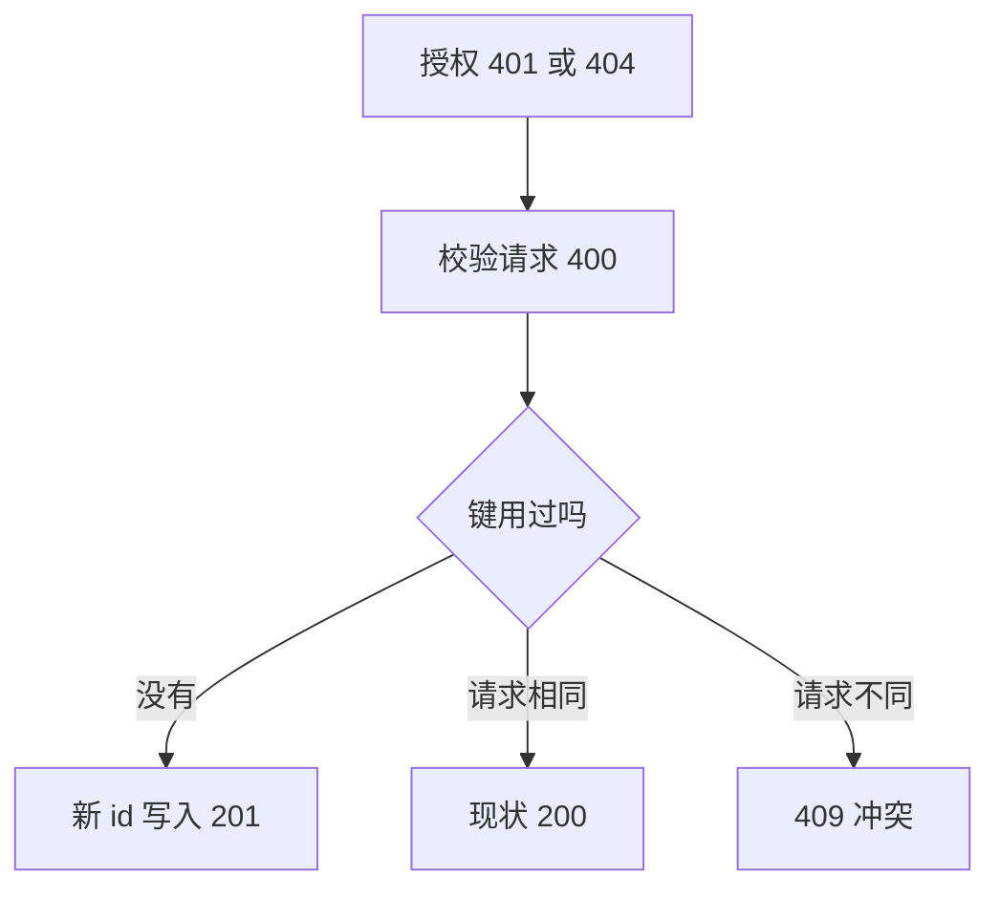

## Q
在项目工单服务（IssueHub）里，你要补 `IssueService` 的四个方法：团队成员创建、查看、开关、翻页列出工单；客户端会带幂等键重试创建，同事会同时改同一张工单；HTTP 适配器已经写好。开工前你会先定下哪几条规则？

## A
**先把合同写成带数字的断言：授权、幂等、版本、分页，各有一条会被隐藏测试卡住的边界**

- **授权先于一切**：401（身份空白）先于 404（非成员或无此项目），再做各方法自己的校验；非成员是 404 不是 403
- **创建输入**：标题去空白后 1..120 且存去空白后的；描述原样、至多 2000；key 长 1..64，空白算内容
- **幂等**：范围是 (用户, 项目, 键)；规范化后相同返回 200 加工单现状，不同是 409；格式错的请求先是 400
- **版本**：必须等于当前版本，空操作也要；状态真的变了才加一
- **失败不留痕**：id 全局递增，失败与重放都不耗 id；先校验后写
- **列表与类型**：id 严格大于游标、升序、先过滤再截断；`bool` 不是整数



```python
def create(self, user, project, payload, key=None):
    board = self._authorize(user, project)    # 401 / 404
    request = NewIssue.parse(payload)         # 400
    with self._lock:
        if key is not None:
            old = board.replay(user, key, request)  # 409
            if old is not None:
                return 200, old.snapshot()
        issue = Issue(self._next_id, project, user,
                      request.title, request.description)
        self._next_id += 1
        board.add(issue, key, request)
        return 201, issue.snapshot()
```

<details class="pt"><summary>延伸</summary>每条规则配一个带数字的测试：`create(" Rotate logs ", key="nightly-1")` 得 201 与 `title: "Rotate logs"`，同键再发得 200。顺序决定两条规则同时被违反时谁赢，要先问清并写进测试。</details>

**知识点：** 接口的错误契约（Error Contract）、边界校验（Validate at the Boundary）、重试与退避（Retry & Backoff）
