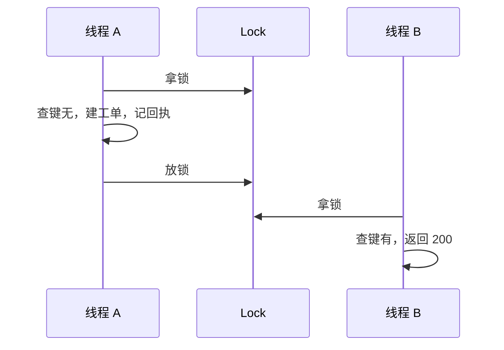

## Q
工单服务的客户端在超时后会带着同一个幂等键重试创建。在这个服务里，哪些操作必须原子化，重试才能可靠地返回已有的工单而不是再建一张？不原子会出什么错？

## A
**查键、分配 id、追加、记回执这四步必须合成一个不可分的动作：同一把锁罩住**

- **原子的是整段**：单独给某一步加锁没用，两步之间仍能被切走
- **不原子的后果**：两个并发的相同请求都查到没用过，各建一张，回执只记后一张，前一张成孤儿
- **回执与追加不可分**：否则第二个线程看到工单已在、回执还没有，会再建一次
- **GIL 不够**：它只保证单条字节码；先检查后动作与 `+= 1` 都是多步
- **失败不留痕**：会抛错的检查都排在第一次写之前，冲突与校验失败不耗 id
- **重放返回现状**：回执持有工单引用，不是首次响应的拷贝



```python
barrier = threading.Barrier(64)
def worker(_):
    barrier.wait()
    return s.create("a", "p", {"title": "x"}, "k")[0]

with ThreadPoolExecutor(64) as pool:
    codes = list(pool.map(worker, range(64)))
assert codes.count(201) == 1
assert codes.count(200) == 63
assert len(s.list("a", "p")) == 1
```

<details class="pt"><summary>延伸</summary>线程池要不小于屏障的线程数，否则测试永远卡住；断言不变量（一个 201、一条工单），不要断言耗时。多进程时线程锁管不到别的进程，原子性要下沉到存储的唯一约束。</details>

**知识点：** 复合操作（Compound Actions）、重试与退避（Retry & Backoff）、线程安全结构的写法（Thread-Safe Structures）
