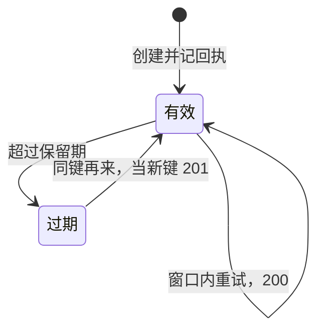

## Q
工单服务把每个幂等键永久保存在内存里，长期运行会无限增长。你要让键过期，同时不破坏客户端的行为：怎么设计？客户端会观察到什么变化？

## A
**回执记创建时间，保留期大于客户端最长的重试窗口；过期后同键就是新键**

- **保留期**：合同没写，是设计取舍；比如 24 小时，必须大于客户端最长重试窗口（等于也不行：窗口末尾的重试会撞上边界），写进接口文档
- **客户端看到的变化**：过期后同样的请求会再建一张工单，所以重试要在窗口内完成
- **内容不同的同键**：过期后不再 409，当新键处理
- **清理方式**：访问时惰性检查（内存不回落），或后台定期批量扫，扫描拿同一把锁
- **处理中的不能清**：正在创建的请求不能被清掉
- **存什么**：请求指纹和工单 id，不存整个请求体，保留期更便宜



```python
TTL = 24 * 3600          # 大于客户端最长重试窗口

def replay(self, user, key, request, now):
    receipt = self._receipts.get((user, key))
    if receipt and now - receipt.at >= TTL:
        del self._receipts[(user, key)]
        return None      # 过期：同键当新键
    if receipt is None:
        return None
    if receipt.request != request:
        raise ServiceError(409, "idempotency_conflict")
    return receipt.issue
```

<details class="pt"><summary>延伸</summary>时钟用注入的假时钟，测试里直接推进到 24 小时零一秒；迁到数据库后，过期变成按创建时间批量删除回执行。</details>

**知识点：** 重试与退避（Retry & Backoff）、接口的错误契约（Error Contract）、大结果集接口（Pagination & Iteration）
