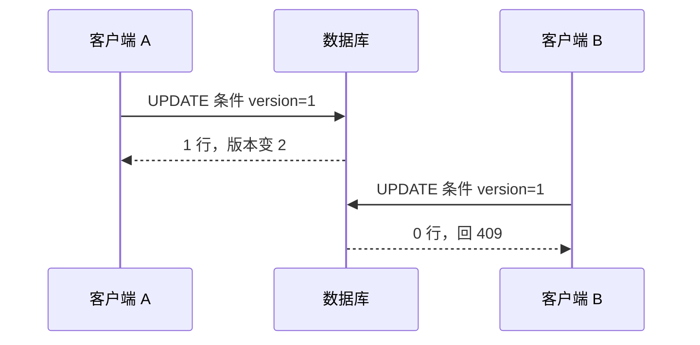

## Q
两个同事同时打开同一张工单的页面，各自读到版本 1，再各自发请求改状态。工单服务把数据放进数据库后，比较「乐观版本检查」和「数据库行锁」：各自怎么工作、什么时候选哪个、代价是什么？

## A
**乐观检查不跨请求持锁，行锁只保单个事务；实际常两者并用**

- **乐观检查**：版本放在行里，条件 `UPDATE` 影响 0 行就是冲突，回 409，客户端重读再决定
- **乐观的代价**：冲突少时几乎没成本；冲突多时客户端反复重试，热点行会饿死
- **行锁**：`SELECT ... FOR UPDATE` 在一个事务里先锁再改，别人排队
- **行锁的限制**：GET 与 PATCH 是两个请求，锁不能在用户思考时一直持有；长事务拖住别人，还可能死锁
- **并用**：版本管跨请求的「你读到的还是最新吗」，条件 `UPDATE` 或行锁管单次写入的原子性



```python
cur = db.execute(
    "UPDATE issues SET status = ?, version = version + 1"
    " WHERE id = ? AND version = ?",
    (status, issue_id, version))
if cur.rowcount == 0:      # 工单已查到：只能是版本变了
    raise ServiceError(409, "version_conflict")
```

<details class="pt"><summary>延伸</summary>这条 `UPDATE` 只适合状态真的变了的请求：状态没变的请求也要核对版本，但不能加版本，要另走一条只比较不写的路径。进程内的版本是同一个想法：比较与修改放进同一个临界区，64 个线程在版本 1 上发 closed，只有一个成功，其余 63 个得 409。</details>

**知识点：** 复合操作（Compound Actions）、重试与退避（Retry & Backoff）、线程安全结构的写法（Thread-Safe Structures）
