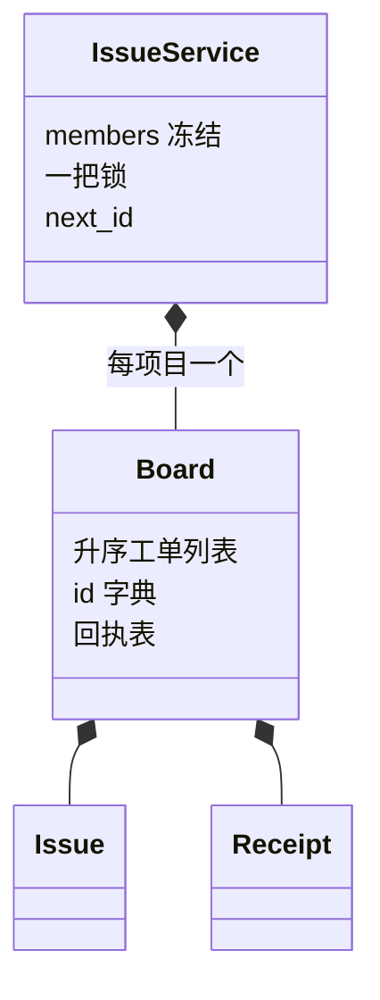

## Q
在项目工单服务里，成员表、每个项目的工单、幂等键的回执、全局 id 计数器都放在内存里，多个线程同时调用。要存哪些状态？每部分用什么结构？哪条不变量最要紧，什么会打破它？

## A
**每个项目一个 `Board`，全实例一把锁；最要紧的不变量是同范围一个键至多一张工单**

- **成员表**：构造时冻结成 `frozenset`，之后改传入的集合不影响授权
- **每项目一个 `Board`**：按 id 升序的列表（id 全局递增，追加即有序）、id 字典、回执表；查找只在本项目内，天然隔离
- **回执**：键是 (用户, 键)，值是规范化后的请求加工单引用；比较是值相等，重放看到现状
- **一把锁加全局 id**：创建、版本比较、读都在锁内；id 只在真的建出工单后加一
- **打破这条不变量**：查键放锁外，两个线程都查到没用过，各建一张
- **打破别的不变量**：先加 id 再查键（id 出现空洞）、`get` 不加锁（读到状态已改、版本未加的半截）、返回内部对象（调用方改动存储）
- **对外只给快照**：`snapshot()` 的字典，改它不影响存储



```python
with self._lock:
    old = board.replay(user, key, request)
    if old is not None:
        return 200, old.snapshot()
    issue = Issue(self._next_id, project, user,
                  request.title, request.description)
    self._next_id += 1       # 最后一个会抛错的语句已过
    board.add(issue, key, request)
```

<details class="pt"><summary>延伸</summary>要让项目之间并行，把锁挪进 `Board`，再配一把只管 id 的小锁；迁到数据库后，回执变成 (用户, 项目, 键) 上带唯一约束的表。</details>

**知识点：** 复合操作（Compound Actions）、防御性拷贝（Defensive Copying）、不变量与封装（Invariants）
