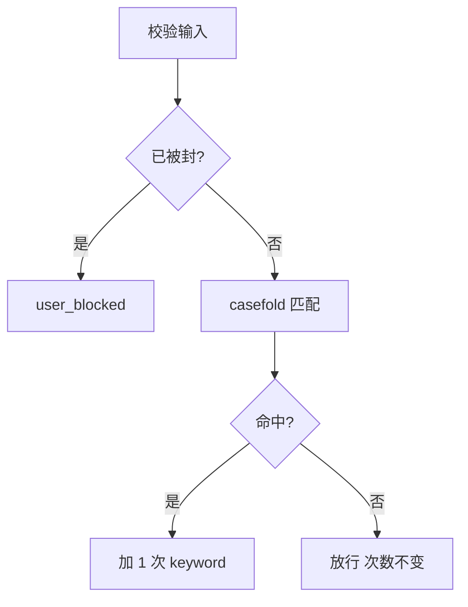

## Q
在讨论区的内容准入组件（ContentGate 的 `BlocklistService`）里，每次发帖前调用 `check(user, content)`：配置有关键词表和手动封禁名单，累计被拒三次自动封禁，多个线程同时调用。开工前你会先定下哪几条规则？

## A
**先校验输入，再判封，再匹配；一个被拒请求只加一次**

- **配置整体校验、整份替换**：裸字符串和 `bytes`、非字符串、空白条目都是 400；失败时旧配置原样保留
- **口径**：关键词 `strip().casefold()` 后去重，内容只 `casefold()`；字面子串匹配，结果排序且无重复
- **用户 ID 原样保存**：区分大小写，两端空白也算 ID，不 `strip`
- **判封在匹配之前**：手动名单里，或次数 ≥ 3；被封时 `matches=[]`，不匹配、不加次数
- **一次一计**：命中几个词、出现几次都只加 1；第三次被拒仍是 `keyword`，之后才是 `user_blocked`
- **干净请求**：放行，次数不清零



```python
def check(self, user, content):
    _require_user(user)                          # 非法输入先抛 400，被封的用户也一样
    if not isinstance(content, str):
        raise ServiceError(400, "invalid_input")
    with self._lock:
        strikes = self._ledger.count(user)
        if self._is_blocked(user):               # 不匹配、不加次数
            return Verdict.blocked(strikes).as_dict()
        matches = self._keywords.find(content)
        if not matches:                          # 干净请求不清零
            return Verdict.clean(strikes).as_dict()
        return Verdict.keyword(matches, self._ledger.add(user)).as_dict()  # 只加一次
```

<details class="pt"><summary>延伸</summary>例子：关键词表 `[" SPAM "]`，`check("alice", "SPAM offer")` 得到 `keyword`、`["spam"]`、`strikes=1`，再发 `"hello"` 放行、仍是 1。</details>

**知识点：** 边界校验（Validate at the Boundary）、接口的错误契约（Error Contract）、规格与契约（Specifications）
