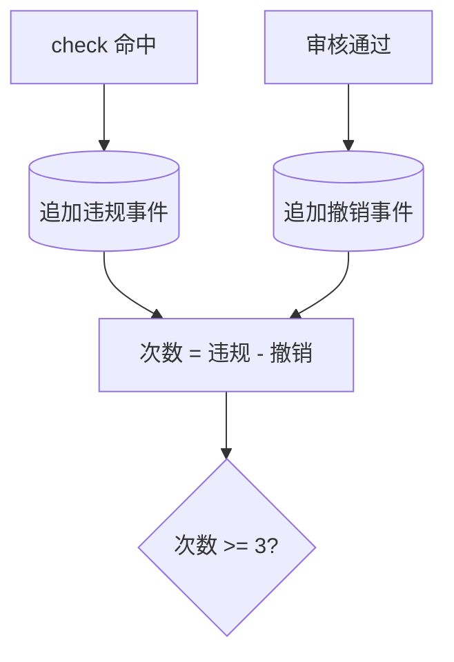

## Q
ContentGate 上线后，被误伤的用户要申诉：审核通过就撤销那一次违规，用户可能因此解封；安全团队却要求任何时候都能还原"谁在何时因为什么内容被拒"。违规次数现在只是账本里的一个整数，你怎么改？

## A
**违规只追加成事件，次数改成查询；撤销也是追加的事件**

- **违规事件**：`Violation(id, user, matches, 时间, 配置版本)`，只追加，不改不删
- **撤销是新事件**：`void(violation_id)`，带审核人和时间；原违规记录原样保留
- **次数是查询**：未被撤销的违规数；被封仍是 `手动名单 或 次数 ≥ 3`
- **接口不变**：账本的 `count`、`exhausted`、`add` 换实现，`check` 和 `state` 一行不改
- **内容怎么存**：存命中的词和内容哈希，不存原文；原文另放，按规定限期保留
- **并发**：读次数和追加事件在同一个事务或同一把锁里，否则会漏封或多封



```python
class EventLedger:
    def __init__(self):
        self._events = []                        # 只追加
    def count(self, user):
        voided = {e[1] for e in self._events if e[0] == "void"}
        return sum(1 for e in self._events
                   if e[0] == "violation" and e[2] == user and e[1] not in voided)
    def add(self, user, matches):
        self._events.append(("violation", len(self._events), user, matches))
        return self.count(user)
    def void(self, violation_id):
        self._events.append(("void", violation_id))
```

<details class="pt"><summary>延伸</summary>放进 SQL 时是违规表和撤销表两张表，次数是 `LEFT JOIN` 后没有撤销记录的行数；热用户可以缓存计数，但以事件为准。</details>

**知识点：** 不变量与封装（Invariants）、值对象与实体（Value vs Entity）、内存持久化（In-Memory Persistence）
