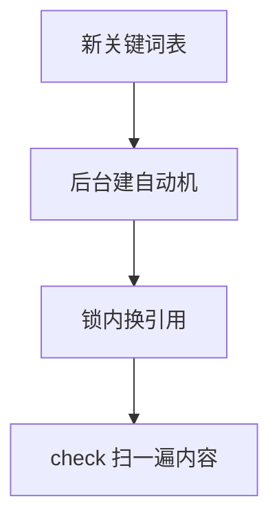

## Q
ContentGate 的关键词表从几十个涨到一百万个，而每次发帖都要在持着锁的时候，把内容和全部关键词逐个比一遍。会出什么问题？匹配和配置更新怎么改？

## A
**逐词扫描随词数线性变慢；换成自动机，后台建好再换引用**

- **症结**：每次 `check` 扫 K 个词，而且在锁里；十万词时约 66 ms 一次，词数每多十倍慢十倍
- **自动机**（Aho–Corasick）：词编成带失败指针的字典树，内容只扫一遍，十万词时约 0.16 ms
- **接口不变**：只换 `Keywords` 的编译与 `find`；结果仍是排序、无重复的列表
- **配置更新**：后台建好新自动机（十万词约 0.4 秒），锁内只换一个引用，请求不会被建树堵住
- **新瓶颈是内存**：十万词的字典树约 221 MB，词本身只有约 5.7 MB；百万级要紧凑数组、C 库，或分片的独立匹配服务
- **正确性**：同一批随机输入下，自动机与逐词扫描的结果完全相同



```python
def find(self, content):
    node, hits = 0, set()
    for ch in content.casefold():
        while node and ch not in self.goto[node]:
            node = self.fail[node]       # 失败：退到最长的、仍是前缀的后缀
        node = self.goto[node].get(ch, 0)
        hits |= self.out[node]           # out 已并入失败链上的词
    return sorted(hits)
```

<details class="pt"><summary>延伸</summary>数字是随机 8 个字母的词、约 2000 字符内容在一台机器上的实测；再大就按词的哈希分到多个匹配节点并行扫描，最后合并排序。</details>

**知识点：** 并行加速与锁竞争（Parallel Speedup & Contention）、不靠锁的线程安全（Immutability & Confinement）、线程安全结构的写法（Thread-Safe Structures）
