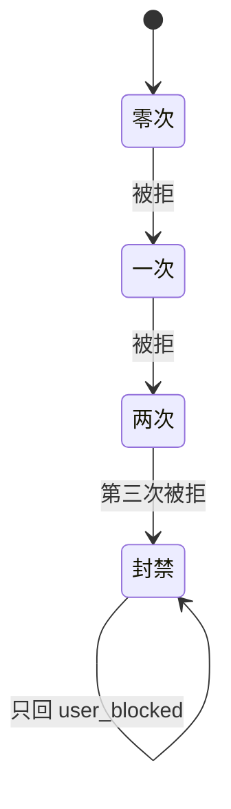

## Q
在 ContentGate 的内容准入组件里，运营正在整体换一张关键词表，同一瞬间另一个线程里有人在发帖。服务要保存哪些状态？哪条不变量最要紧？那个发帖请求看到的是旧表还是新表？

## A
**一把锁加一次引用替换；次数最多到 3，"被封"由名单和次数算出来**

- **三份状态**：关键词表（不可变对象）、手动名单（`frozenset`）、违规账本（用户到次数）
- **一把锁**：罩住判封、匹配、记账；并发的调用排成一个串行顺序，所以第 4 次一定是 `user_blocked`
- **整份替换**：用户给的迭代器在锁外读完并校验，锁内只换一个引用；请求看到整份旧表或整份新表，不会混合
- **被封是算出来的**：`在手动名单里 或 次数 ≥ 3`，不另存标志，所以移出名单后的结果不会和次数对不上
- **最要紧的不变量**：次数不超过 3；被封用户不再记账，`add` 到上限时抛异常，不用 `assert`
- **只记违规的用户**：`state` 与干净请求不往账本里建条目



```python
class StrikeLedger:
    def count(self, user):
        return self._counts.get(user, 0)         # 查询不建条目
    def exhausted(self, user):
        return self.count(user) >= self._limit
    def add(self, user):
        if self.exhausted(user):                 # 安全不变量：异常，不是 assert
            raise RuntimeError("user already at the strike limit")
        self._counts[user] = self.count(user) + 1
        return self._counts[user]

def replace_keywords(self, keywords):
    compiled = Keywords.compile(keywords)        # 锁外读迭代器、整体校验
    with self._lock:
        self._keywords = compiled                # 一次引用替换
```

<details class="pt"><summary>延伸</summary>次数放进数据库时，记账变成 `UPDATE strikes SET n = n + 1 WHERE user = ? AND n < 3`，看影响行数；进程内的锁不再是正确性的来源。</details>

**知识点：** 不变量与封装（Invariants）、复合操作（Compound Actions）、不靠锁的线程安全（Immutability & Confinement）
