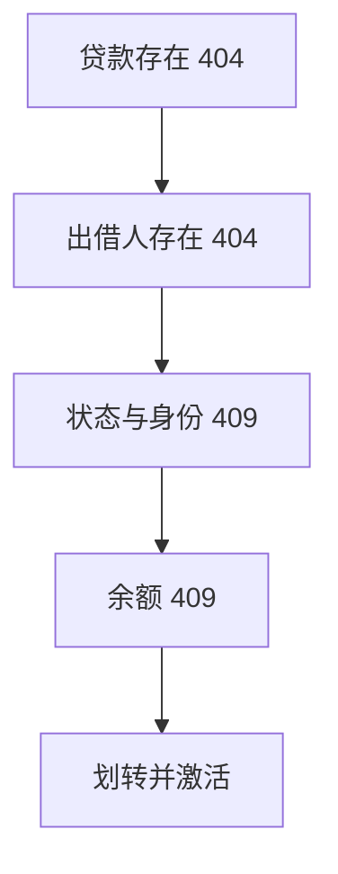

## Q
你接手一个内存里的贷款服务（LedgerBridge）：借款人说贷款创建完就查不到，放款后余额对不上，还款莫名其妙失败。动手改代码之前，你会先定下哪几条规则？

## A
**金额只认正 int、检查顺序固定、状态单向、失败不留痕、余额守恒、返回快照**

- **金额只认正 int**：布尔、浮点、字符串、0、负数都是 400 invalid_amount；创建里金额先于借款人
- **检查顺序固定**：放款是贷款 → 出借人 → 状态与身份 → 余额；还款是金额 → 贷款 → 归属 403 → 状态与超额 409 → 余额；同时违规谁先谁赢，要写进测试
- **状态单向**：pending → active → repaid；只有 pending 能放款，只有 active 能还款；自己借给自己是 invalid_state
- **失败不留痕**：贷款、余额、编号都和调用前一样；全部检查通过才开始写
- **余额守恒**：只有划转能动余额，总和不变、没有负数；余额恰好等于本金或欠款也够
- **返回快照**：构造时复制传入的余额，返回的字典与内部状态无关；编号只给成功的创建



```python
def fund(self, loan_id, lender):
    with self._lock:  # 贷款状态与账本放在同一把锁里
        loan = self._find(loan_id)  # 1 贷款存在
        self._ledger.balance(lender)  # 2 出借人存在
        loan.ensure_fundable(lender)  # 3 pending，且不是自己借给自己
        self._ledger.transfer(lender, loan.borrower, loan.principal)  # 4 余额够才划转
        loan.activate(lender)  # 5 转账成功后才改状态
        return loan.snapshot()
```

<details class="pt"><summary>延伸</summary>顺序之所以要测，是因为"同时违反两条规则"的输入最容易暴露错位：已放款的贷款被余额不足的人再次放款，必须得到 invalid_state 而不是 insufficient_balance。</details>

**知识点：** 接口的错误契约（Error Contract）、边界校验（Validate at the Boundary）、非法转移与幂等（Illegal Transitions）
