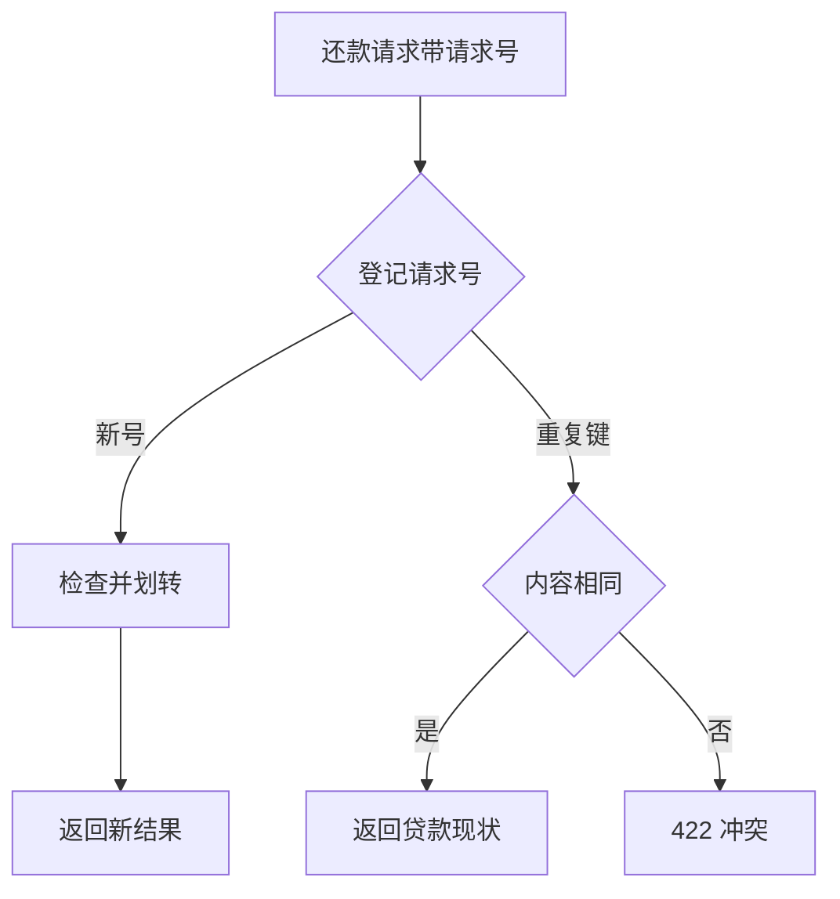

## Q
贷款服务（LedgerBridge）的还款接口已经禁止了超额还款。手机端网络不稳，客户端会重发同一个还款请求。为什么还要另做幂等？两者各防什么？

## A
**超额检查看贷款的状态，幂等看请求的身份；前者挡"还多了"，后者挡"同一个请求被执行两次"**

- **超额检查只看总额**：欠 60 时重发的 20 并不超额，会被当成第二笔再扣 20
- **幂等看请求号**：每次还款带客户端生成的请求号，同一个号只生效一次
- **同号同内容是重放**：不再动钱，返回贷款现状，仍是成功，不是 409
- **同号不同内容是冲突**：既不能当重放，也不能当新请求，返回 422
- **登记与划转同一个事务**：`(loan_id, request_id)` 唯一约束；失败时登记一起回滚，重试等于第一次
- **两者缺一不可**：幂等挡重发，超额检查挡"不同请求"的多还；还清后重发最后一笔，没有请求号只能得到 409，客户端分不清"成功过了"还是"真的错了"



```python
def repay(db, loan_id, borrower, amount, request_id):  # sqlite3 参考写法
    with db:  # 登记与划转在同一个事务里
        try:
            db.execute("INSERT INTO repayments VALUES (?, ?, ?)", (loan_id, request_id, amount))
        except sqlite3.IntegrityError:  # 这个请求号处理过了
            old = db.execute("SELECT amount FROM repayments WHERE loan_id = ? AND request_id = ?",
                             (loan_id, request_id)).fetchone()[0]
            if old != amount:
                raise ServiceError(422, "request_id_reused")  # 同号不同内容：冲突
            return read_loan(db, loan_id)  # 重放：不再动钱
        apply_repayment(db, loan_id, borrower, amount)  # 平常的检查与划转，抛错则登记一并回滚
        return read_loan(db, loan_id)
```

<details class="pt"><summary>延伸</summary>请求号要有保留期：保留期过后同一个号会被当成新请求；放款不需要请求号，因为"pending 变 active"本身只会发生一次。</details>

**知识点：** 重试与退避（Retry & Backoff）、非法转移与幂等（Illegal Transitions）、复合操作（Compound Actions）
