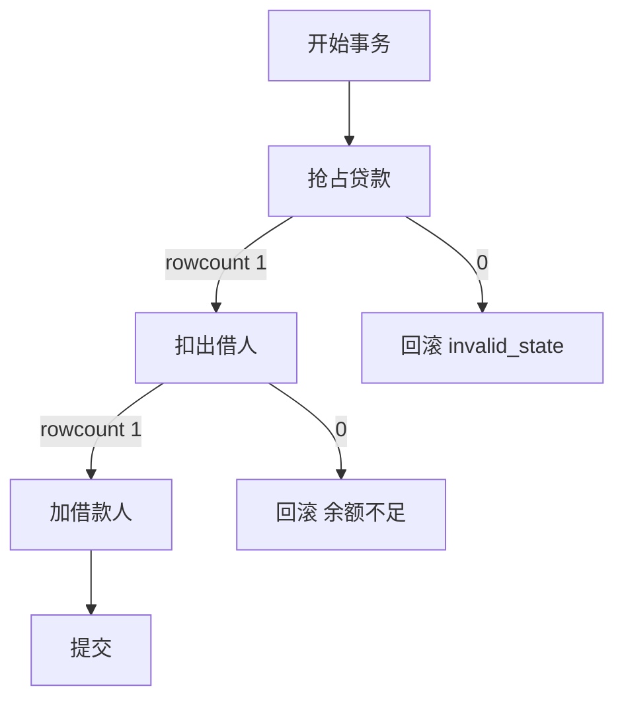

## Q
贷款服务（LedgerBridge）要从进程内的字典搬到几个服务实例共用的事务型数据库：余额一张表，贷款一张表。怎样保持"贷款只放款一次、余额守恒"？进程内那把锁换成什么？

## A
**锁换成事务加条件更新：抢占贷款的状态，再带下限扣款，任何一步失败整体回滚**

- **一次放款是一个事务**：抛错就整体回滚；进程内的锁管不到别的进程
- **抢占靠条件更新**：`UPDATE loans … WHERE status = 'pending'`，`rowcount == 1` 才算抢到；检查和修改是同一条语句
- **余额下限写进条件**：`cents >= ?`，不先读后写；表上再加 `CHECK (cents >= 0)` 做最后一道网
- **错误顺序靠语句顺序**：先抢占、再扣款，所以 invalid_state 仍先于 insufficient_balance；扣款失败时回滚，贷款回到 pending
- **按固定顺序锁账户**：一笔转账碰两个账户，两个反向转账会互相等；先按用户 id 排序锁住，再更新
- **锁变细**：行锁只锁涉及的行，原来的全局锁不再需要



```python
def fund(db, loan_id, lender):  # sqlite3 参考写法
    with db:  # 一个事务：抛错即整体回滚
        borrower, principal = db.execute(
            "SELECT borrower, principal FROM loans WHERE id = ?", (loan_id,)).fetchone()
        claimed = db.execute("UPDATE loans SET status = 'active', lender = ? "
                             "WHERE id = ? AND status = 'pending' AND borrower != ?", (lender, loan_id, lender))
        if claimed.rowcount != 1:
            raise ServiceError(409, "invalid_state")  # 同一笔只有一个事务抢得到
        paid = db.execute("UPDATE accounts SET cents = cents - ? WHERE user = ? AND cents >= ?",
                          (principal, lender, principal))
        if paid.rowcount != 1:
            raise ServiceError(409, "insufficient_balance")  # 回滚：贷款仍是 pending
        db.execute("UPDATE accounts SET cents = cents + ? WHERE user = ?", (principal, borrower))
```

<details class="pt"><summary>延伸</summary>SQLite 一次只允许一个写事务，所以这段没有死锁；换成 PostgreSQL 要先 `SELECT … WHERE user IN (…) ORDER BY user FOR UPDATE` 把两个账户按固定顺序锁住；再往后，账户分库就要用流水加对账代替跨库事务。</details>

**知识点：** 内存持久化（In-Memory Persistence）、复合操作（Compound Actions）、死锁及其亲戚
