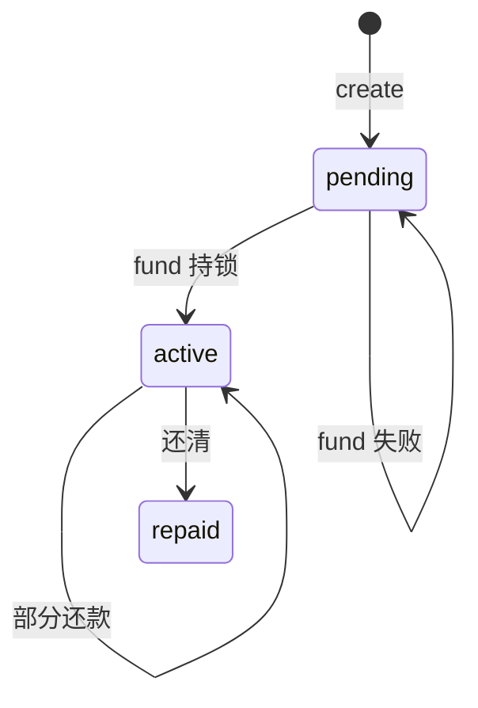

## Q
贷款服务（LedgerBridge）里，十六个出借人在同一时刻抢着给同一笔 pending 贷款放款。服务要存哪些状态？哪条不变量保证这笔贷款只放款一次，你怎样测它？

## A
**贷款状态只前进，"检查 pending"和"扣款并改 active"在同一次持锁里完成**

- **状态四样**：账本的余额表、贷款表（编号到贷款）、下一个编号、一把锁
- **检查与修改不可分**：先看 pending 再划转，两步之间不能有别的线程插进来；没有锁，十六个线程可以都看到 pending
- **一把锁罩两个对象**：贷款状态和账本的联动才需要原子，所以锁放在服务上，不放进账本或贷款里
- **失败的放款什么都不改**：余额不够时贷款仍是 pending，之后别人还能放款
- **测法**：屏障让十六个线程同时放款，恰好一个成功、其余是 invalid_state，赢家余额恰好扣掉本金，所有余额之和不变
- **GIL 下漏锁也可能侥幸通过**：所以另写一条确定性的规则测试，同一笔贷款放两次，第二次必须 409



```python
def test_one_winner():
    service = LoanService({"ann": 0, **{f"l{i}": 100 for i in range(16)}})
    loan = service.create("ann", 100)
    barrier = threading.Barrier(16)

    def attempt(i):
        barrier.wait()  # 十六个线程同时出发
        try:
            return service.fund(loan["id"], f"l{i}")["status"]
        except ServiceError as error:
            return error.code

    with ThreadPoolExecutor(16) as pool:
        results = list(pool.map(attempt, range(16)))
    assert sorted(results) == ["active"] + ["invalid_state"] * 15
```

<details class="pt"><summary>延伸</summary>多个服务实例共用一个数据库时，进程内的锁失效，"只放款一次"改由一条带条件的更新来保证（见下一张）。</details>

**知识点：** 不变量与封装（Invariants）、复合操作（Compound Actions）、测试并发代码（Testing Concurrency）
