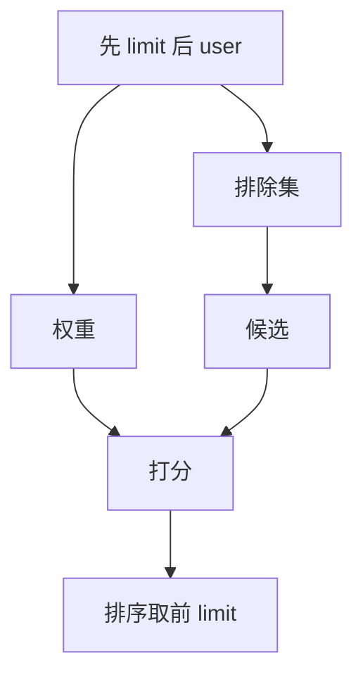

## Q
你接手电影推荐服务（NextFrame）：用户明明有评分和观看记录，推荐列表却是空的、排错序的，甚至还有他评过分的片子。动手改代码之前，你会先定下哪几条规则？

## A
**先定排除集、权重公式、三级排序键、`limit` 边界，再定复制边界**

- **排除集是并集**：评过分的并上看过的，再去掉下架的；评过分就排除，不管几分、看没看过
- **权重是 `rating - 3`**：3 分是中性；下架的电影照样贡献，目录里已经没有的评分忽略，观看记录不产生权重
- **分数是不同类型的权重之和**：类型先去重；负分、零分的候选照样保留
- **排序键是三级**：分数降序、热度降序、id 升序；冷启动用户全是 0 分，只剩热度和 id
- **`limit` 是 1 到 50，含 50**：先校验 `limit`、再校验 `user`；布尔不算整数；返回最多 `limit` 条
- **进出各复制一次**：构造时复制嵌套输入，返回的每一行都是新字典



```python
def recommend(self, user, limit=10):
    if not valid_limit(limit):
        raise ServiceError(400, "invalid_limit")
    if not valid_user(user):
        raise ServiceError(400, "invalid_user")
    viewer = self._viewer(user)
    profile = TasteProfile.build(self._catalogue, viewer.ratings)
    eligible = self._catalogue.candidates(viewer.seen)
    scored = (Scored(m, profile.score(m)) for m in eligible)
    best = heapq.nsmallest(limit, scored, key=attrgetter("order_key"))
    return [item.to_dict() for item in best]
```

<details class="pt"><summary>延伸</summary>规则一共五处容易写错：50 含不含、评过分排不排除、3 分算几、平局的 id 方向、要不要按 `limit` 截断；公开测试只覆盖其中一处，其余要自己写测试。</details>

**知识点：** 边界校验（Validate at the Boundary）、防御性拷贝（Defensive Copying）、规格与契约（Specifications）
