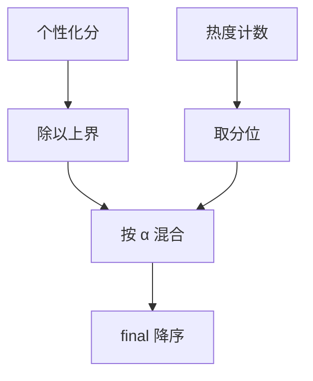

## Q
电影推荐服务（NextFrame）现在把热度只当平局键。产品想把热度也算进分数，让冷门佳片之外的大片也能靠前，但担心热度是几百万的计数、个性化分数只有个位数，一相加热度就淹没一切。你怎么设计这个新策略？

## A
**先把两边放到同一个尺度，再给热度设一个上限份额**

- **热度换成分位**：在目录里按热度排名，取 0 到 1 的百分位（或取对数），不直接用原始计数
- **个性化分除以上界**：用候选里最大的绝对值归一到 -1 到 1；没有个性化数据（冷启动）时它是 0，热度自然决定
- **加权混合**：`final = (1 - α) * 个性化 + α * 热度分位`，`α` 设上限（例如不超过 0.3），热度永远只占小头
- **保留平局键**：`final` 相同再比热度、再比 id，排序仍是全序
- **监控压倒程度**：看前 10 名里热度分位的中位数，它随 `α` 陡增就说明热度开始压倒个性化



```python
def blended(personal: int, bound: int, pop_rank: float, alpha: float = 0.3) -> float:
    fit = personal / bound if bound else 0.0        # 个性化分归一到 [-1, 1]
    return (1 - alpha) * fit + alpha * pop_rank     # 热度只占 alpha 的份额

# Scored.order_key 里把 -self.score 换成 -blended(...)，其余两级不动
```

<details class="pt"><summary>延伸</summary>不同策略要上线对比时，把评分函数做成可传入的参数，用同一批请求同时算两种结果；这时才值得引入策略对象。</details>

**知识点：** 策略模式与可替换算法（Strategy）、规格与契约（Specifications）
