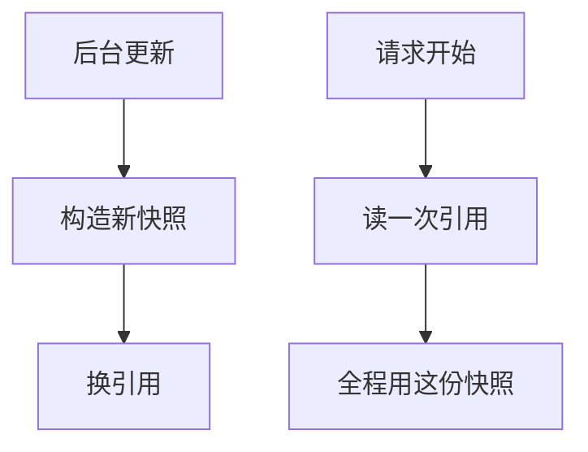

## Q
电影推荐服务（NextFrame）的片库和用户评分每分钟都会被后台任务更新，而一次推荐请求要先读目录、再读评分、最后排序。怎样保证一次请求内部不会拿新目录配旧评分，响应里还能说清这批结果是哪一版数据算的？

## A
**一次请求只读一个不可变快照，写入方换整份快照**

- **快照是一个冻结的值**：版本号加目录、评分、观看记录，构造后任何人都不改它
- **请求开头读一次引用**：`snap = self._snapshot`，之后目录、评分、观看记录全从 `snap` 取，中途不再碰服务的字段
- **写入方构造新快照再换引用**：一次赋值，读者看到的不是旧的就是新的，不会半新半旧
- **响应带上 `snap.version`**：排查"这批推荐是哪一版数据"时有据可查
- **换成数据库**：整个请求放在一个读事务里（`REPEATABLE READ` 或快照隔离），一个请求一个一致的视图



```python
@dataclass(frozen=True)
class Snapshot:
    version: int
    catalogue: Catalogue
    ratings: Mapping[str, Mapping[int, int]]
    history: Mapping[str, frozenset[int]]

def recommend(self, user, limit=10):
    snap = self._snapshot                 # 只读一次，之后全用 snap
    ...

def publish(self, snap: Snapshot) -> None:
    self._snapshot = snap                 # 一次赋值换整份快照
```

<details class="pt"><summary>延伸</summary>评分量很大时，快照不必整份复制：用持久化（共享结构）的映射，只让变动的用户那一支是新的，其余指向旧快照。</details>

**知识点：** 防御性拷贝（Defensive Copying）、可变性与别名（Mutability & Aliasing）、不变量与封装（Invariants）
