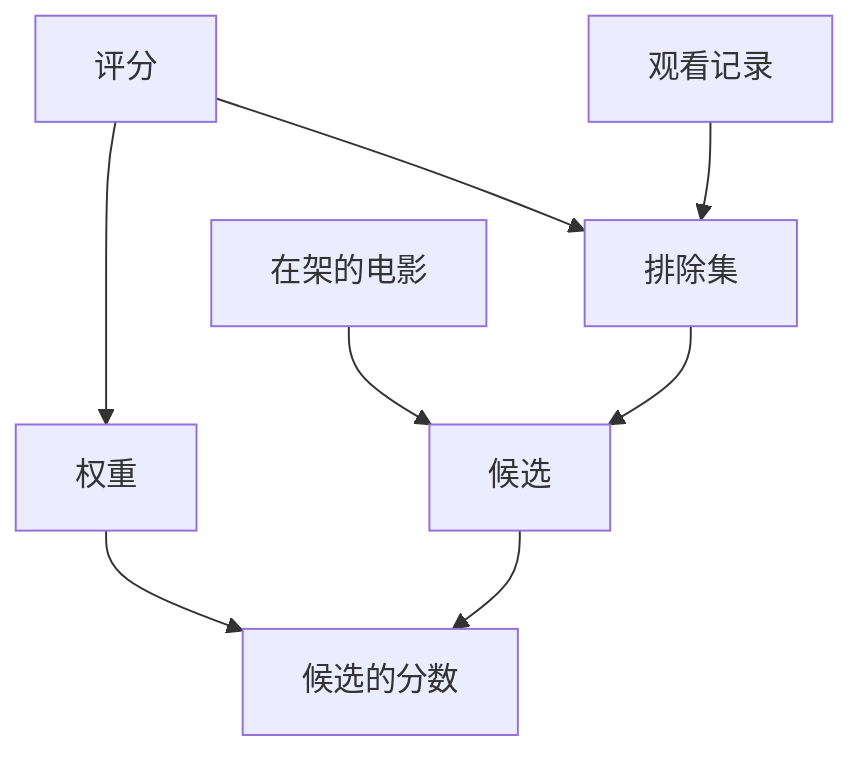

## Q
在电影推荐服务（NextFrame）里，一部电影被用户评过 5 分，但已经下架。它该不该出现在这个用户的推荐里？它的评分还该不该影响别的电影的分数？服务要保存哪些状态，哪条不变量最要紧？

## A
**排除决定谁能出现，评分决定谁排前面：两个集合各读各的**

- **它不出现**：评过分、看过、下架，任一条都排除；排除只发生在 `Catalogue.candidates` 一个地方
- **它的评分照样贡献**：权重只从评分和完整目录算，不看 `available`，所以下架的电影仍塑造口味
- **孤立评分两头都无效**：目录里没有的 id，排除不了任何东西，也贡献不了任何东西
- **服务只存三份冻结的数据**：目录（冻结的 `Movie`）、每个用户的评分、每个用户的观看集合；请求不改它们，所以不需要锁
- **最要紧的不变量**：排除集与权重分开计算；把"评过分就 `continue`"写进算权重的循环，下架电影的口味就丢了



```python
class Viewer:                          # 一个用户自己的数据
    ratings: Mapping[int, int]
    watched: frozenset[int]

    @property
    def seen(self) -> frozenset[int]:
        return frozenset(self.ratings) | self.watched   # 评过的并上看过的

def candidates(self, excluded):        # Catalogue：排除只在这里
    return (m for m in self._by_id.values()
            if m.available and m.id not in excluded)
```

<details class="pt"><summary>延伸</summary>评分很多、目录很大时，权重可以在写评分时增量维护；这时才有缓存失效的问题，现在每次请求从评分重算，没有这类不一致。</details>

**知识点：** 不变量与封装（Invariants）、防御性拷贝（Defensive Copying）、值对象与实体（Value vs Entity）
