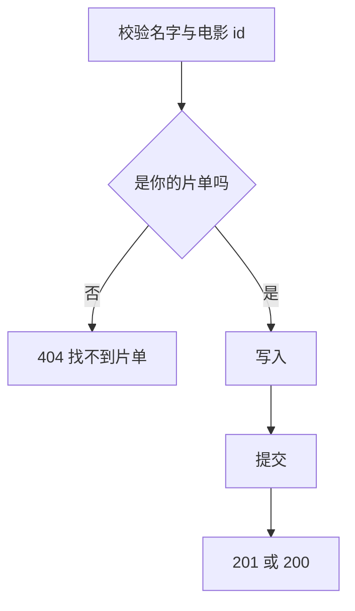

## Q
你接手片单服务（ScreenShelf，SQLite）：用户反馈同一部电影加两次也提示"新建成功"，还能读到别人的片单，删一张片单别的片单也不见了。动手改代码之前，你会先定下哪几条规则？

## A
**先定输入怎么归一、归属怎么报错、201 与 200 怎么分、删除与移除的范围，再定提交**

- **名字先 `strip` 再校验**：长度 1 到 80 个字符，库里存的是 `strip` 之后的值；电影 id 恰好是 `int`，1 到 2147483647，布尔不算
- **"不存在"和"别人的"同一个 404**：都是 `list_not_found`，外人探测不出别人有没有片单；校验先于归属，被拒绝的操作什么都不改
- **添加有两种成功**：真的新增 201，已经在里面 200，两种都返回片单
- **删除与移除只动请求的那一行**：移除先查片单、后查电影，缺失的电影 `movie_not_found`；删除一张片单带走它的成员，别的片单原样
- **提交在返回之前**：同一路径上的第二个实例立刻读得到；片单 id 删除后不复用



```python
def add_movie(self, user, list_id, movie_id):
    movie = check_movie(movie_id)              # 先校验，后归属
    with self._store.transaction():
        if not self._store.owns(user, list_id):
            raise list_missing()               # 不存在和别人的：同一个 404
        inserted = self._store.add_entry(list_id, movie)
        return (201 if inserted else 200), self._snapshot(user, list_id).to_dict()
```

<details class="pt"><summary>延伸</summary>起始代码有五处缺陷（名字没归一、查询没带所有者、重复添加写死 201、移除的条件写成"不等于"、删除的条件写成"不等于"），三个公开测试只抓到重复添加这一处，其余四处要自己写测试。</details>

**知识点：** 边界校验（Validate at the Boundary）、接口的错误契约（Error Contract）、规格与契约（Specifications）
