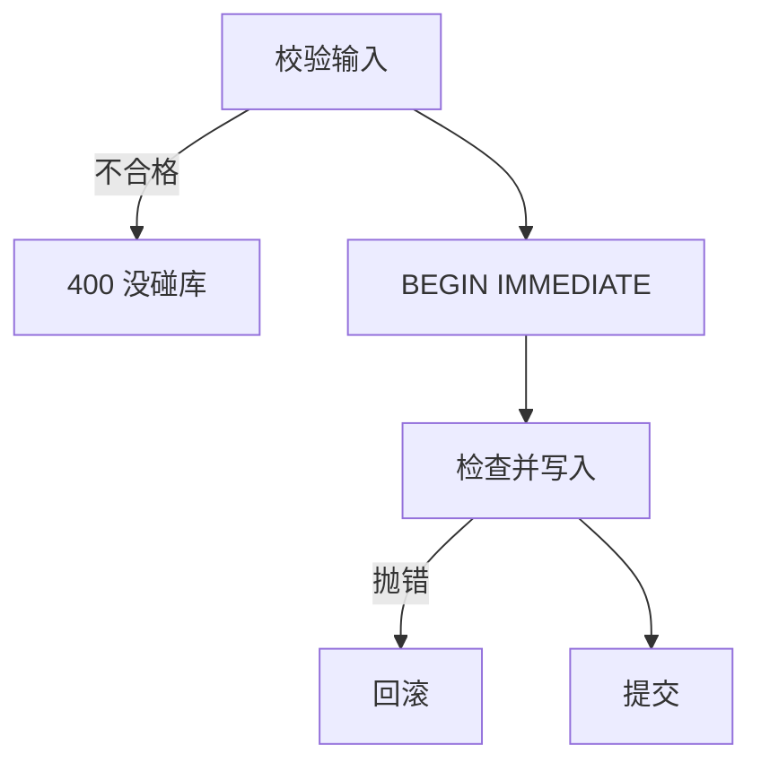

## Q
片单服务（ScreenShelf）同时收到三种失败的请求：往别人的片单里加电影，往自己的片单里加一个非法的电影 id，以及一个写到一半抛了异常的请求。怎样保证这三种失败都不改动库里已有的数据，而成功的请求返回之前一定已经提交？

## A
**校验放在事务之外，一个写操作一个事务，异常穿过上下文管理器就回滚**

- **坏参数不开事务**：名字、电影 id 在 `with` 之前校验，失败时库一次都没碰
- **一个写操作一个事务**：业务里的 `raise ServiceError(404, …)` 穿过 `with` 就回滚，没有第二种出口，十个方法不用写十份撤销
- **提交在返回之前**：退出 `with` 时 `commit()`，返回的是事务里读出来的快照，第二个实例马上看得到
- **`BEGIN IMMEDIATE` 一开始就取写锁**：显式的延迟 `BEGIN` 先读后写，升级写锁时撞上另一个连接的写事务，会立刻 `database is locked`；`IMMEDIATE` 把等待放在开头
- **同一连接上一把锁**：别的线程的语句不会混进这个事务，也不会被它的回滚带走



```python
@contextmanager
def transaction(self):
    with self._lock:                       # 一个连接同一时刻一个事务
        self._conn.execute("BEGIN IMMEDIATE")
        try:
            yield
        except BaseException:
            self._conn.rollback()          # 任何异常都撤销这个事务的写入
            raise
        self._conn.commit()                # 返回之前提交
```

<details class="pt"><summary>延伸</summary>多个进程高并发写同一个文件时：打开 WAL、设置 `busy_timeout`、对"忙"做带抖动的重试；写入仍是单写者，写入量再涨就换成客户端服务器型的数据库。</details>

**知识点：** 复合操作（Compound Actions）、所有路径上的清理（Cleanup on Every Path）、测试并发代码（Testing Concurrency）
