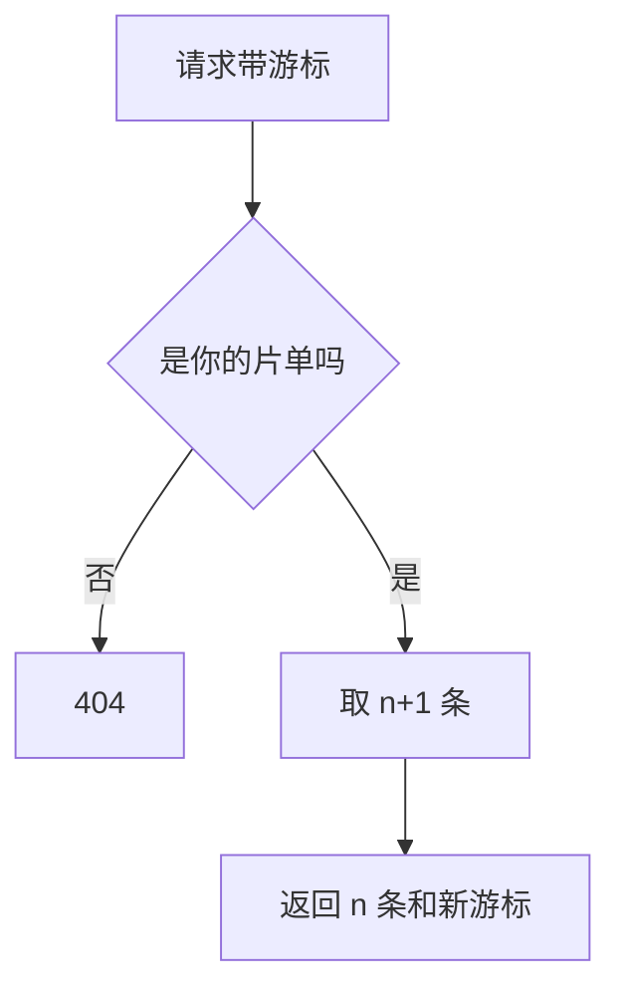

## Q
片单服务（ScreenShelf）里有人的一张片单存了几十万部电影，接口要一页一页地返回。怎样分页，才不会越翻越慢、不会在翻页期间漏项或重复，又不会让别人借一个游标读到不属于他的片单？

## A
**键集分页，游标只是位置，每页重查所有者**

- **键集，不用 `OFFSET`**：`movie_id > 游标` 走主键索引，一次定位；`OFFSET` 每页从头数，翻页期间增删会漏项或重复
- **多取一条**：取 `n+1` 条，多出的那条说明还有下一页，返回时去掉
- **所有者不进游标**：游标只是一个电影 id；每页请求都在同一个事务里先查归属再取页，伪造游标最多拿到自己片单的另一段
- **空页要分清**："片单不存在"是 404，"没有更多"是 200 加空列表，所以归属检查不能省成"取不到就 404"
- **排序键是全序**：同一张片单里 `movie_id` 唯一，不会因为同值而丢项



```python
def list_movies(self, user, list_id, after=0, limit=50):
    with self._store.transaction():
        if not self._store.owns(user, list_id):
            raise list_missing()               # 每页都重新检查
        rows = self._store.page(list_id, after, limit + 1)
    more = len(rows) > limit
    return rows[:limit], (rows[limit - 1] if more else None)
# page 的 SQL：SELECT movie_id FROM entries
#   WHERE list_id = ? AND movie_id > ? ORDER BY movie_id LIMIT ?
```

<details class="pt"><summary>延伸</summary>要按加入时间排序时，主键不再是排序键：游标改成 `(加入时间, movie_id)` 一对值，并给这一对建联合索引，否则键集分页退化成全表扫描。</details>

**知识点：** 大结果集接口（Pagination & Iteration）、内存持久化（In-Memory Persistence）、接口的错误契约（Error Contract）
