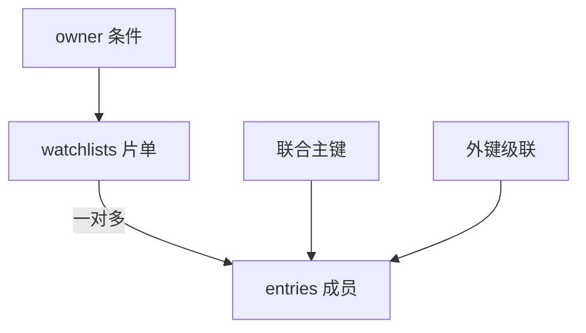

## Q
片单服务（ScreenShelf）把片单和里面的电影存进 SQLite。要建哪几张表、哪些约束？哪条不变量最要紧？删掉一张片单之后，它的成员和它的 id 各会怎样？

## A
**两张表，所有者条件进每条语句，重复与级联交给数据库声明**

- **`watchlists(id, owner, name)`**：`id` 用 `AUTOINCREMENT`，删除后不复用，旧链接不会指向别人的新片单
- **`entries(list_id, movie_id)`**：联合主键 `(list_id, movie_id)`，同一张片单里同一部电影只有一行；同一部电影放进另一张片单是另一行
- **外键 `ON DELETE CASCADE`**：删片单带走成员；`PRAGMA foreign_keys = ON` 要在每个连接上设，忘了就留下孤儿行，接口上还看不出来
- **最要紧的不变量**：读写片单的每条语句都带 `owner`；起始代码的读取函数漏了它，五个方法一起越权
- **服务不存状态**：返回的是冻结的 `Watchlist` 快照，调用方改返回值伤不到库



```python
SCHEMA = """
CREATE TABLE IF NOT EXISTS watchlists (
    id INTEGER PRIMARY KEY AUTOINCREMENT,
    owner TEXT NOT NULL, name TEXT NOT NULL);
CREATE TABLE IF NOT EXISTS entries (
    list_id INTEGER NOT NULL REFERENCES watchlists (id) ON DELETE CASCADE,
    movie_id INTEGER NOT NULL,
    PRIMARY KEY (list_id, movie_id));
"""
conn.execute("PRAGMA foreign_keys = ON")       # 按连接设置
```

<details class="pt"><summary>延伸</summary>id 不复用后，孤儿行从接口上看不到；参考解多放了一个只读的 `membership_count`（测试辅助，不在真实工作区的接口里），测试靠它确认删除一张有两部电影的片单后，成员行恰好少两行。</details>

**知识点：** 内存持久化（In-Memory Persistence）、不变量与封装（Invariants）、值对象与实体（Value vs Entity）
