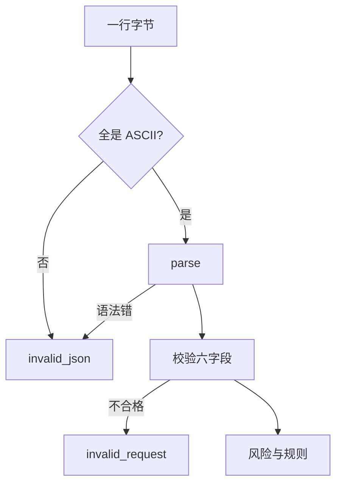

## Q
在退货策略引擎（ParcelPolicy）里，驱动一行读一个 JSON 请求，解析器和评估器对同样的输入给出前后不一致的结果。动手修之前，你会先定下哪几条规则？

## A
**先定六条规则，每条配一个会失败的测试，再让智能体动手。**

- **子集语法**：扁平对象；值只有 64 位整数、布尔、ASCII 字符串；数组、`null`、小数、指数、`\u`、非 ASCII、原始控制字符全拒
- **整数**：形如 `-?(0|[1-9][0-9]*)`，64 位两端含，溢出拒绝而不是变成 0；`true` 不是整数
- **完整与唯一**：截断、对象后多余内容、解码后重复的键，都是 `invalid_json`
- **校验先于决定**：恰好六个字段，类型恰好是 `int` 或 `bool`，六个验完才判，错误是 `invalid_request`
- **边界含下界**：金额 10000、50000，账龄 30、180 归从它起算的那一档；窗口条件是 `> 30`；顺序 final_sale、窗口、opened_high_value、high_risk
- **行隔离**：一行一结果；空行是 `invalid_json`；坏行不影响后面的行；被拒绝的请求也返回风险分



```python
_REJECTIONS = (  # 顺序就是优先级，第一条命中的赢
    ("final_sale", lambda r, risk: r.final_sale),
    ("window_expired", lambda r, risk: r.days_since_purchase > 30),
    ("opened_high_value", lambda r, risk: r.opened and r.value_cents >= 10_000),
    ("high_risk", lambda r, risk: risk >= 60),
)

def evaluate(request):
    parsed = ReturnRequest.from_mapping(request)  # 先全部校验
    risk = parsed.risk
    reason = next((n for n, hit in _REJECTIONS if hit(parsed, risk)), "eligible")
    return Decision(reason == "eligible", reason, risk)
```

<details class="pt"><summary>延伸</summary>

规则变成几十条、由运营维护时，把这张表放进配置并在加载时校验顺序与字段名；表的形状不变，仍是"第一条命中的赢"。

</details>

**知识点：** 边界校验（Validate at the Boundary）、解析错误（Parse Errors）、用例选择（Partitioning & Boundaries）
