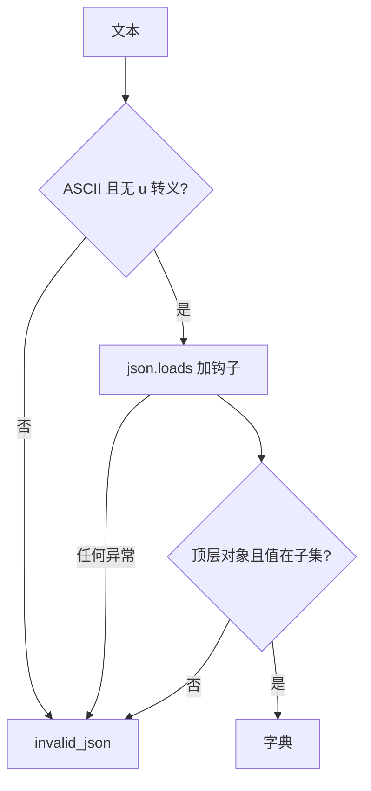

## Q
在退货策略引擎里，产品要求把手写的子集解析器换成维护中的 JSON 库，而且每一行输入的结果都不能变。你怎么做？

## A
**库只管语法；子集规则留在库外，换之前冻结行为，换之后对拍。**

- **先冻结行为**：现有测试加变异种子集当特征测试，换之前全绿
- **钩子拦一部分**：`parse_float`、`parse_constant` 抛错拒绝小数与 NaN；`object_pairs_hook` 发现重复键就抛
- **库放过的要自己查**：`\u` 转义、非 ASCII、DEL、顶层不是对象、值是数组或 `null`、整数超出 64 位
- **所有失败映射成同一个码**：库的 `ValueError` 和深层嵌套的 `RecursionError` 都变成 `invalid_json`，库自己的消息不外漏
- **并跑再切**：旧新两套实现跑同一批输入，差异为零才切；对不上的地方先判断是旧的错还是新的错



```python
_BAD = re.compile(r"[^\x00-\x7e]|(?<!\\)(?:\\\\)*\\u")  # 非 ASCII、DEL、\u

def parse_with_library(text):
    if type(text) is not str or _BAD.search(text):
        raise InvalidJson
    try:
        data = json.loads(text, parse_float=_reject, parse_constant=_reject,
                          object_pairs_hook=_unique_keys)
    except (ValueError, RecursionError):  # 库的任何失败都映射成同一个错误码
        raise InvalidJson from None
    if type(data) is not dict or not all(_in_subset(v) for v in data.values()):
        raise InvalidJson
    return data
```

<details class="pt"><summary>延伸</summary>

库升级也会改变边界行为，所以对拍测试要长期留在持续集成里；性能敏感时可以只在发版前跑大样本对拍。

</details>

**知识点：** CSV 与 JSON 的稳健读写（CSV & JSON）、核心重构手法、验证输出（Verification）
