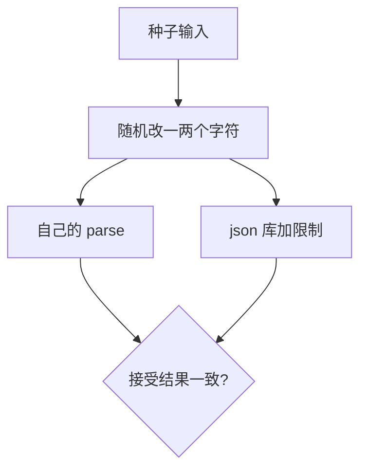

## Q
在退货策略的 JSON 解析器上，同事担心两件事：超大的数字被悄悄吞成 0，对象后面多出来的内容被漏掉。你用哪几类测试证明这两件事都安全？

## A
**边界两侧加极端长度，每种尾部各一条，再用标准库对拍。**

- **上下限两侧**：`2**63-1`、`-2**63` 接受；`2**63`、`-2**63-1` 拒绝，而且不是 0
- **极端长度**：二十位、五千位的数字；错误消息仍是 `invalid_json`，不能变成 `int()` 的位数限制提示
- **数字形状**：`-0` 接受；`+1`、`01`、`-01`、`1.0`、`1e5` 拒绝
- **完整消费**：合法对象后接 `x`、`{}`、`,`、`}`、`0`、控制字符，各一条；尾部纯空白接受
- **断言精确的消息**：用 `match="^invalid_json$"`，不是只断言抛出了异常
- **对拍**：标准 `json.loads` 加上子集限制当参照，对种子输入的随机变异逐个比较接受与否



```python
@pytest.mark.parametrize("n", [2**63, -2**63 - 1, 10**19, "9" * 5000])
def test_overflow_is_invalid_json(n):
    with pytest.raises(ValueError, match="^invalid_json$"):
        parse('{"n":' + str(n) + "}")

@pytest.mark.parametrize("tail", ["x", "{}", ",", "}", "0", "\x00"])
def test_object_must_consume_all_input(tail):
    with pytest.raises(ValueError, match="^invalid_json$"):
        parse('{"a":1}' + tail)

def test_limits_are_accepted():
    assert parse(f'{{"a":{2**63 - 1},"b":{-2**63}}}') == {"a": 2**63 - 1, "b": -2**63}
```

<details class="pt"><summary>延伸</summary>

输入空间更大时，用性质测试（property-based testing）自动生成输入，同一个参照函数照样当判官；变异用固定的随机种子，保证失败可以重现。

</details>

**知识点：** 用例选择（Partitioning & Boundaries）、解析错误（Parse Errors）、验证输出（Verification）
