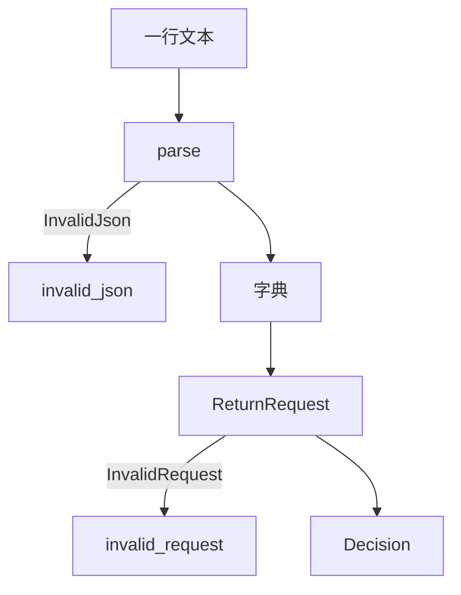

## Q
在退货策略引擎里，一个进程连续处理很多行请求，其中有 `{"rating":"x"` 和 `{"rating":"x"}` 这样的坏行。要保存哪些状态？哪条不变量最要紧？这两行各该得到什么错误？

## A
**无跨行状态；语法错与策略错分两层，语法先于策略。**

- **没有跨行状态**：解析器的位置指针和结果字典只活在一次 `parse` 里，坏行无处污染后面的行
- **两层各有一种错**：语法层只抛 `InvalidJson`，策略层只抛 `InvalidRequest`；都是 `ValueError`，`str(error)` 就是错误码
- **语法先于策略**：第一行少了 `}`，是 `invalid_json`；第二行语法对、类型错，是 `invalid_request`
- **校验成值**：`ReturnRequest` 能构造出来，就说明六个字段齐全、类型与范围都对；规则只看它，不再碰字典
- **按名字捕获**：驱动只接这两种错；`UnicodeDecodeError` 也是 `ValueError`，要单独接它，不能靠 `except ValueError` 兜底，否则解码提示会漏进输出
- **`evaluate` 自己也校验**：被直接调用时没有解析器替它把关



```python
@classmethod
def from_mapping(cls, request):
    if not isinstance(request, dict) or request.keys() != FIELDS:
        raise InvalidRequest
    rating = request["rating"]
    if not (type(rating) is int and 1 <= rating <= 5
            and all(_is_count(request[k]) for k in
                    ("value_cents", "account_age_days", "days_since_purchase"))
            and type(request["opened"]) is bool
            and type(request["final_sale"]) is bool):
        raise InvalidRequest
    return cls(**request)
```

<details class="pt"><summary>延伸</summary>

要上监控时，两层各一个计数器：`invalid_json` 多半指向上游编码或截断，`invalid_request` 多半指向调用方契约变化。因为没有共享状态，按行并行处理也不用加锁，输出顺序靠行号恢复。

</details>

**知识点：** 解析错误（Parse Errors）、错误类型体系（Error Taxonomy）、边界校验（Validate at the Boundary）
