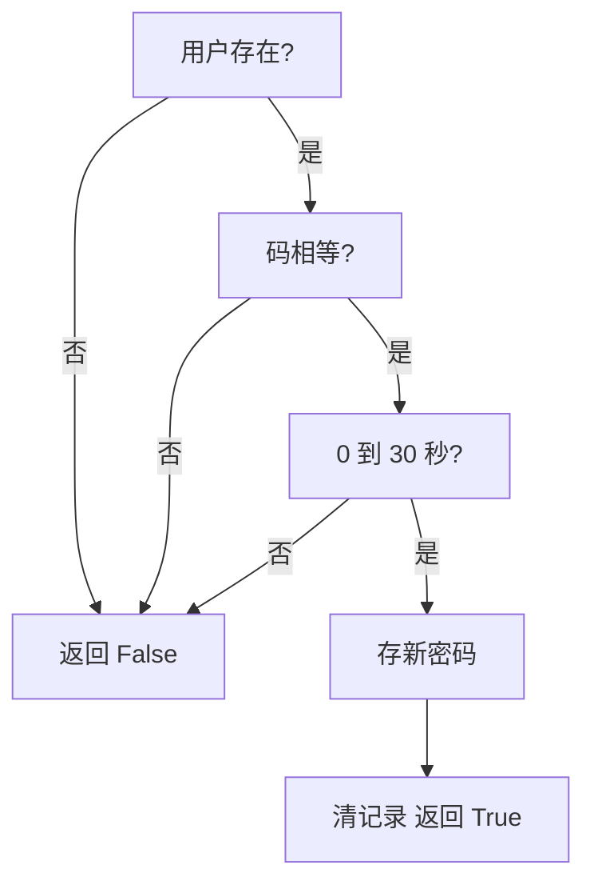

## Q
你接手一个密码重置服务（PasswordResetService）：用户请求重置码，30 秒内凭码改密码。用户反馈码过期时间不对、返回成功但密码没变、同一个码能用两次。动手改代码之前，你会先定下哪几条规则？

## A
**配置快照、码唯一、[0, 30) 秒、失败不留痕、先存后消耗**

- **配置只读一次**：构造时快照 `INTERNAL_AUTH_URL`，设了就原样保留（空串、空白也不动），没设才用默认值
- **码唯一**：同一实例生成的码不重复（用过也不再出现），也不等于该用户当前存着的码，撞上就重试
- **窗口 [0, 30) 秒**：按时刻比较；旧记录无时区就当 UTC；0 与 29.9 有效，30 与负年龄无效
- **失败不留痕**：任何 `False` 都不改密码、不动记录；错码不消耗有效码
- **先存后消耗**：一次 `update_password`，再 `clear_reset_code`；重放（含换实例）得 `False`
- **按用户隔离**：用户在校验时才查是否存在；码只属于存它的那个用户



```python
def verify_and_reset(self, user_id, code, new_password):
    if not self._store.user_exists(user_id):
        return False
    record = self._store.record_of(user_id)
    if record is None or record.code != code:
        return False
    if not self._window.accepts(record.age(self._clock())):
        return False
    self._store.consume(user_id, new_password)  # 先存密码，再清记录
    return True
```

<details class="pt"><summary>延伸</summary>多个实例共享数据库时，"查记录、判时间、改密码、清记录"要合成库里的一个事务，见并发那张卡。</details>

**知识点：** 规格与契约（Specifications）、时间与数字（Time & Numbers）、接口的错误契约（Error Contract）
