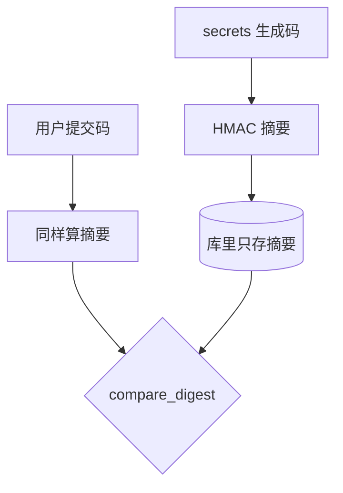

## Q
一个密码重置服务（PasswordResetService）的原型用 `random.randint` 生成四位数字码，码明文存在库里，密码只是在前面加了个前缀。要给真实账户用，你会改哪三处？每处为什么？

## A
**码用安全随机数，库里只存摘要，密码用慢速加盐哈希**

- **生成**：用 `secrets`（操作系统的安全随机源）；`random` 的输出可以被预测
- **存摘要**：库里存码的 HMAC（带服务端密钥）；库泄露时拿到的不是可提交的码
- **常量时间比较**：用 `hmac.compare_digest`，不用 `==`，不从耗时泄露前缀
- **密码哈希**：scrypt、argon2 或 bcrypt，每个用户随机盐；`"hashed_" + 密码` 只是占位
- **短码必须限次**：四位数字只有一万种，没有尝试上限就能穷举



```python
def new_code() -> str:
    return secrets.token_urlsafe(6)

def digest(code: str, server_key: bytes) -> str:
    return hmac.new(server_key, code.encode(), hashlib.sha256).hexdigest()

def matches(stored: str, submitted: str, server_key: bytes) -> bool:
    return hmac.compare_digest(stored, digest(submitted, server_key))

def hash_password(password: str) -> str:
    salt = secrets.token_bytes(16)
    key = hashlib.scrypt(password.encode(), salt=salt, n=2**14, r=8, p=1)
    return salt.hex() + "$" + key.hex()
```

<details class="pt"><summary>延伸</summary>服务端密钥放在密钥管理系统里并支持轮换；摘要里带密钥版本号，换钥时新旧两版都能校验一段时间。</details>

**知识点：** 边界校验（Validate at the Boundary）、不变量与封装（Invariants）
