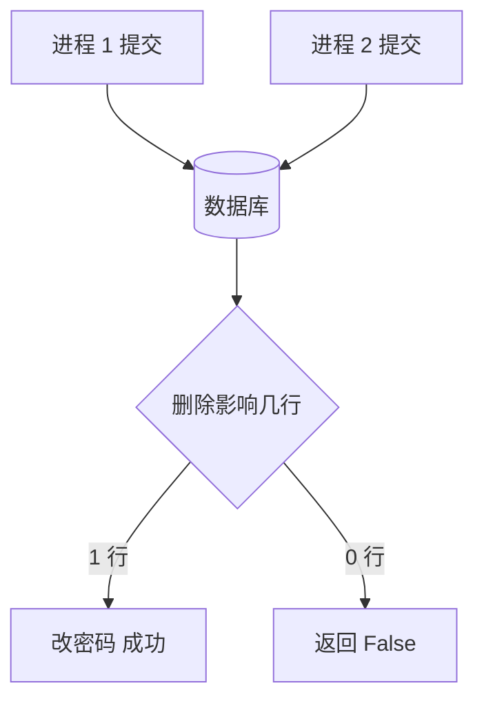

## Q
密码重置服务（PasswordResetService）要扩成四个进程共用一个关系数据库。现在两个请求同时提交同一个有效码，两个都可能成功；攻击者可以对一个用户连续猜码；各台机器的时钟还差几秒。你会怎么改，才能让一个码只成功一次、猜码有上限、过期判断可靠？

## A
**把"消耗"做成库里一条带条件的删除；次数和过期也交给库**

- **条件删除即消耗**：`DELETE … WHERE user_id=? AND code=? AND 没过期`，影响一行才算成功，并发者只有一个拿到那一行
- **改密码与删记录同一事务**：要么都生效，要么都不发生；密码没写成功，码仍可用
- **进程内的锁没用**：`threading.Lock` 只管一个进程，GIL 也不让"先查再改"变成一步
- **尝试次数存在库里**：错码时 `attempts = attempts + 1` 原子自增，到上限就删记录，要求重新请求
- **统一时间来源**：记录里存创建时刻，比较用库的 `now()`，不用各实例的时钟



```python
def consume(conn, user_id, code, now, new_hash):
    with conn:  # 一个事务：下面两条要么都生效，要么都不生效
        cur = conn.execute(
            "DELETE FROM reset_codes"
            " WHERE user_id = ? AND code = ? AND created_at <= ? AND ? < created_at + 30",
            (user_id, code, now, now),
        )
        if cur.rowcount != 1:  # 0 行：码错、过期或已被别人消耗
            return False
        conn.execute("UPDATE users SET password_hash = ? WHERE id = ?", (new_hash, user_id))
        return True
```

<details class="pt"><summary>延伸</summary>吞吐更高时，用 Redis 的 `GETDEL` 之类的单命令原子读删；要跨库保证，就让消耗成为数据库里唯一的写入点。</details>

**知识点：** 复合操作（Compound Actions）、线程安全结构的写法（Thread-Safe Structures）、原子操作与无锁（Atomics & Lock-Free）
